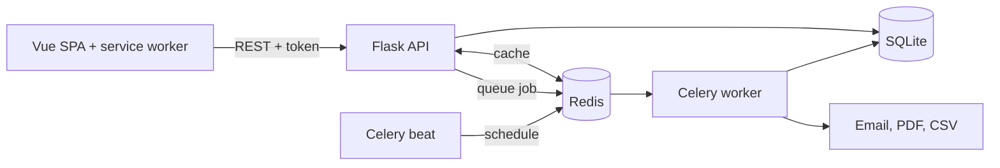

# TMA: Trekking Management Application

A full-stack trek booking platform with separate portals for admins, trek leaders and trekkers, built with Flask, Vue 3, Redis and Celery.


## Features

### Admin
- Create, edit and delete treks, assign trek leaders, add trek-specific packing items
- Create staff accounts (login details are emailed), blacklist or restore users
- See all bookings, and search across users, staff and treks
- Reports with six charts for any date range, plus a PDF download
- Moderate reviews: hide, restore or delete

### Trek staff
- Dashboard of assigned treks and participants
- Update free seats and open or close a trek
- Start and complete treks; trekkers are notified at each step
- View participants and the waitlist

### Trekker
- Browse with search, difficulty, location, duration and rating filters
- Book a seat, then pay within a 30-minute hold (simulated UPI, card or net banking)
- Join a waitlist when a trek is full, and cancel for a recorded refund
- Packing checklist, reviews, completion certificate PDF and CSV export of bookings
- Notification bell and an installable app

## Engineering highlights

- **Overbooking prevention:** a seat is claimed by one conditional `UPDATE` (`WHERE status = 'Open' AND available_slots > 0`), so the check and the decrement can't be separated. A partial unique index blocks duplicate active bookings.
- **Waitlist promotion:** a freed seat goes to the first person waiting inside the same transaction that freed it, as a Pending booking with its own 30-minute hold. Nobody else can take the seat in between.
- **Unpaid holds:** a scheduled job releases seats unpaid after 30 minutes. A conditional `UPDATE` means a payment landing at the same moment wins.
- **Caching:** trek listings and admin data are cached in Redis, with per-range keys for reports, invalidated whenever the data changes. If Redis is down, requests fall back to the database.
- **Background jobs:** Celery sends email, builds PDF and CSV files, and runs daily reminders, a monthly report and the auto-cancel job on a schedule.
- **PWA:** a manifest and service worker make the app installable and let its shell load offline. API responses are never cached.
- **Access control:** token authentication with role checks on every endpoint. Staff can only manage their own treks, and blacklisting takes effect on the next request.

## Tech stack

| Layer | Technology |
|---|---|
| Frontend | Vue 3 and Vue Router (ES modules, no build step), Bootstrap 5, Chart.js |
| Backend | Python, Flask, Flask-Security-Too, Flask-SQLAlchemy |
| Database | SQLite |
| Cache and queue | Redis |
| Background jobs | Celery worker and beat |
| Email and PDF | Flask-Mail (MailHog locally), xhtml2pdf |

## Architecture



## Screenshots

| | |
|---|---|
| **Login**<br> | **Register**<br> |
| **Admin dashboard**<br> | **Reports**<br> |
| **Manage treks**<br> | **Staff dashboard**<br> |
| **Manage trek**<br> | **Trekker dashboard**<br> |
| **Browse treks**<br> | **Trek details**<br> |
| **Checkout success**<br> | **My bookings**<br> |
| **History**<br> | **Certificate PDF**<br> |
| **Monthly report email**<br> | **Phone view**<br> |

## Setup on macOS

**Prerequisites:** [Homebrew](https://brew.sh) and Python 3.12.

```bash
brew install redis mailhog

python3 -m venv venv
source venv/bin/activate
pip install -r requirements.txt

cp .env.example .env
```

Open `.env` and set `SECRET_KEY`, `SECURITY_PASSWORD_SALT` and `ADMIN_PASSWORD`. Use `admin123` as the password to match the demo logins below.

Create the database and demo data:

```bash
python create_initial_data.py          # safe to run again: only adds what's missing
python create_initial_data.py --reset  # deletes all data and rebuilds fresh demo data
```

Then run these five commands, each in its own terminal (activate the venv in the last three):

```bash
redis-server
mailhog
python app.py
celery -A tasks.celery_app worker --loglevel=info
celery -A tasks.celery_app beat --loglevel=info
```

Open the app at <http://127.0.0.1:5001> and the MailHog inbox at <http://127.0.0.1:8025>. The app uses port 5001 because macOS AirPlay takes 5000.

## Demo logins

| Role | Email | Password |
|---|---|---|
| Admin | `admin@tma.com` | `admin123` |
| Staff | `staff1@tma.com` | `staff123` |
| Trekker | `trekker1@tma.com` | `user123` |

Payments are simulated. A **card number ending in 0000 fails**, so you can try the retry flow; any other valid number succeeds.

## Project structure

```text
.
├── app.py                    # Flask app factory, blueprints, error handlers
├── config.py                 # Settings, read from .env
├── extensions.py             # db, security, cache, mail
├── models.py                 # SQLAlchemy models
├── create_initial_data.py    # Tables, roles, admin and demo data (--reset)
├── routes/                   # REST API, one blueprint per area
├── tasks/
│   ├── celery_app.py         # Celery setup and beat schedule
│   ├── tasks.py              # Background jobs
│   └── templates/            # Email, report and certificate templates
├── utils/                    # Seat rules, cache, validators, PDF, helpers
├── templates/index.html      # The single page that loads the Vue app
├── static/
│   ├── css/  img/  media/
│   ├── js/                   # Vue app: components/, pages/, utils/, router, store
│   ├── manifest.json
│   └── service-worker.js
└── docs/                     # API docs, ER diagram, wireframe, screenshots
```

- [API documentation](docs/api_endpoints.md)
- [ER diagram](docs/er_diagram.png) ([SVG](docs/er_diagram.svg))

## What I learned

- Race conditions are best solved in the database: a single conditional `UPDATE` is simpler and safer than checking in Python and then writing.
- Everything that moves a seat belongs in one place. Routes and Celery jobs share the same functions, so the rules can't drift apart.
- A cache is only as good as its key and its invalidation. Reports once ignored the selected dates because every range shared one fixed key.
- Slow work belongs in background jobs, which also means handling their failure and showing progress in the UI.
- Testing whole user journeys in a real browser finds bugs that testing endpoints alone misses.

## Future improvements

- A real payment gateway, with webhooks and real refunds
- PostgreSQL and database migrations in place of SQLite
- An automated test suite running in CI
- Push notifications for the installed app
- Ratings that carry across departures of the same trek
