# TMA: Trekking Management Application

A full-stack trek booking platform with separate portals for admins, trek leaders and trekkers.


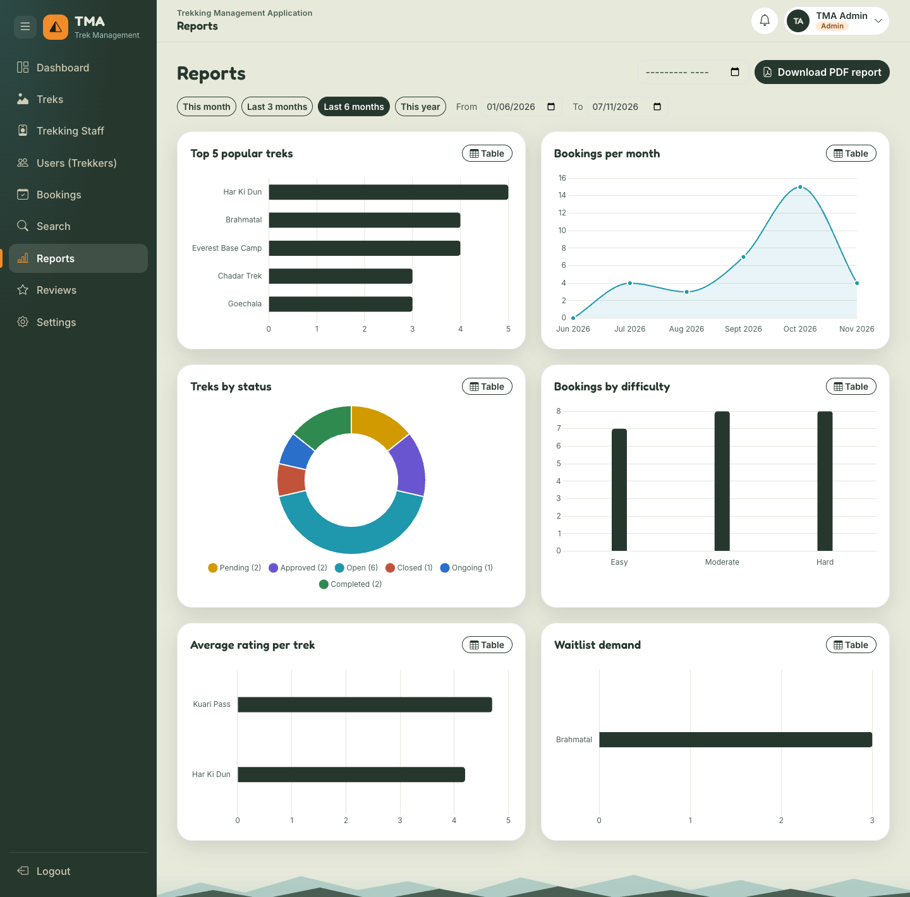

## About the project

Trek companies often take bookings over phone calls and spreadsheets, which leads to overbooked seats, unpaid "reservations" and lost demand when a trek is full. TMA puts the whole flow in one web app: trekkers book and pay with a 30-minute seat hold, full treks get an automatic waitlist, trek leaders run their treks, and the admin manages everything and sees reports.

## Features

### Admin
- Dashboard with totals and the latest bookings
- Create, edit and delete treks, assign trek leaders, add trek-specific packing items
- Create staff accounts (login details are emailed), blacklist or restore users
- All bookings with filters, and one search box for users, staff and treks
- Reports: six charts for any date range, and a PDF report
- Review moderation: hide, restore or delete

### Trek staff
- Dashboard of assigned treks and participants
- Change free seats and open or close a trek
- Start and complete treks; trekkers are notified at each step
- Participant list and waitlist for each trek

### Trekker
- Browse with search, difficulty, location, duration and rating filters
- Book a seat and pay within a 30-minute hold (simulated UPI, card or net banking)
- Join a waitlist when a trek is full; cancel with a recorded refund
- Packing checklist, reviews, completion certificate PDF and CSV export of bookings
- Notification bell, emails, and an installable app

## Engineering highlights

- **Overbooking prevention:** a seat is claimed by one conditional `UPDATE` (`WHERE status = 'Open' AND available_slots > 0`), so two people can never get the last seat. A partial unique index blocks duplicate active bookings.
- **Waitlist promotion:** a freed seat goes to the first person waiting inside the same transaction that freed it, as a Pending booking with its own 30-minute hold.
- **Payment simulation with auto-cancel:** realistic attempts, declines (card ending in 0000) and refunds. A scheduled job releases seats left unpaid for 30 minutes, and a payment arriving at the same moment safely wins.
- **Redis caching:** trek listings, admin stats and reports are cached with role-aware, per-range keys and invalidated after every change. If Redis is down, the app falls back to the database.
- **Celery jobs:** booking emails, daily trek reminders, a monthly report emailed as HTML and PDF, and the CSV export, which the UI polls until it's ready.
- **PDF reports and certificates:** generated from HTML templates with xhtml2pdf.
- **Notifications:** saved in the same transaction as the event they describe, shown in a bell that refreshes on its own.
- **PWA:** a manifest and service worker make the app installable and let its shell load offline. API responses are never cached.

## Tech stack

| Layer | Technology | Purpose |
|---|---|---|
| Frontend | Vue 3, Vue Router (ES modules, no build step) | Single-page app, one portal per role |
| UI | Bootstrap 5, Bootstrap Icons, Chart.js | Layout, components, report charts |
| Backend | Python, Flask | REST API with one blueprint per area |
| Auth | Flask-Security-Too, bcrypt | Roles, hashed passwords, token authentication |
| Database | SQLite, Flask-SQLAlchemy | Storage, models, transactions |
| Cache and queue | Redis, Flask-Caching | Response cache, Celery broker and results |
| Background jobs | Celery worker and beat | Emails, PDFs, CSV export, scheduled jobs |
| Email and PDF | Flask-Mail (MailHog locally), xhtml2pdf, Jinja2 | Email templates, report and certificate PDFs |
| PWA | Web app manifest, service worker | Installable app, offline app shell |

## Architecture

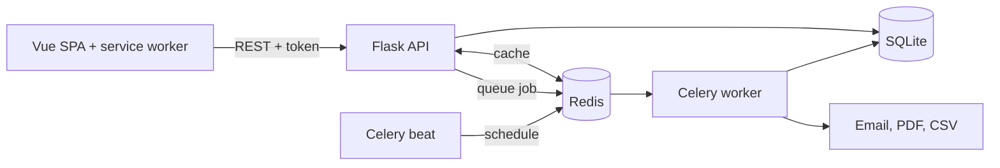

## Screenshots

| | |
|---|---|
| **Login**<br> | **Register**<br> |
| **Admin dashboard**<br>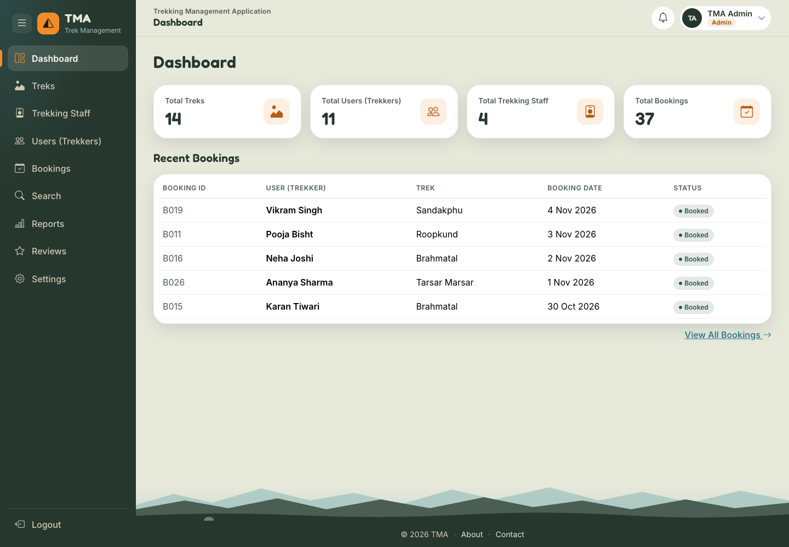 | **Reports**<br> |
| **Manage treks**<br>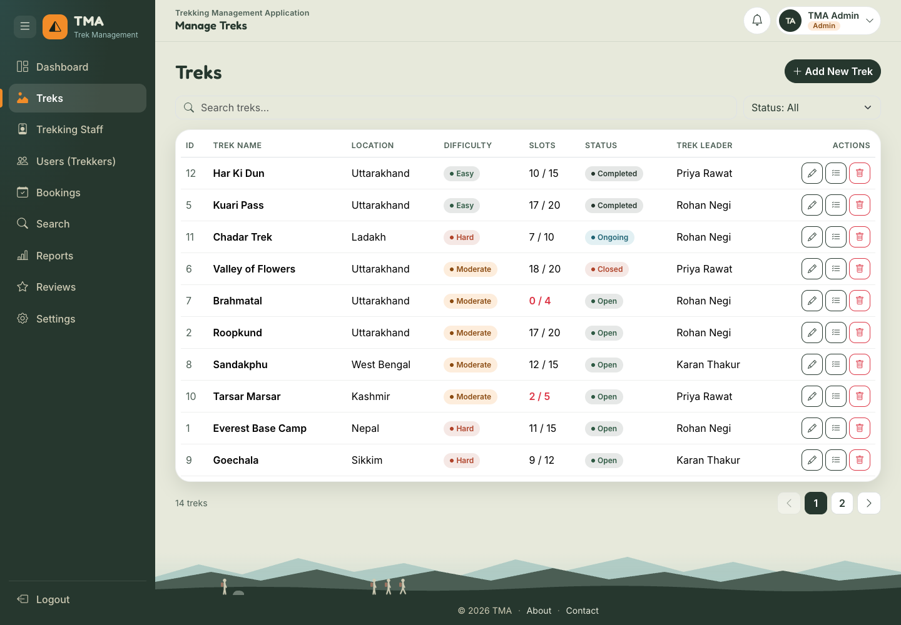 | **Staff dashboard**<br>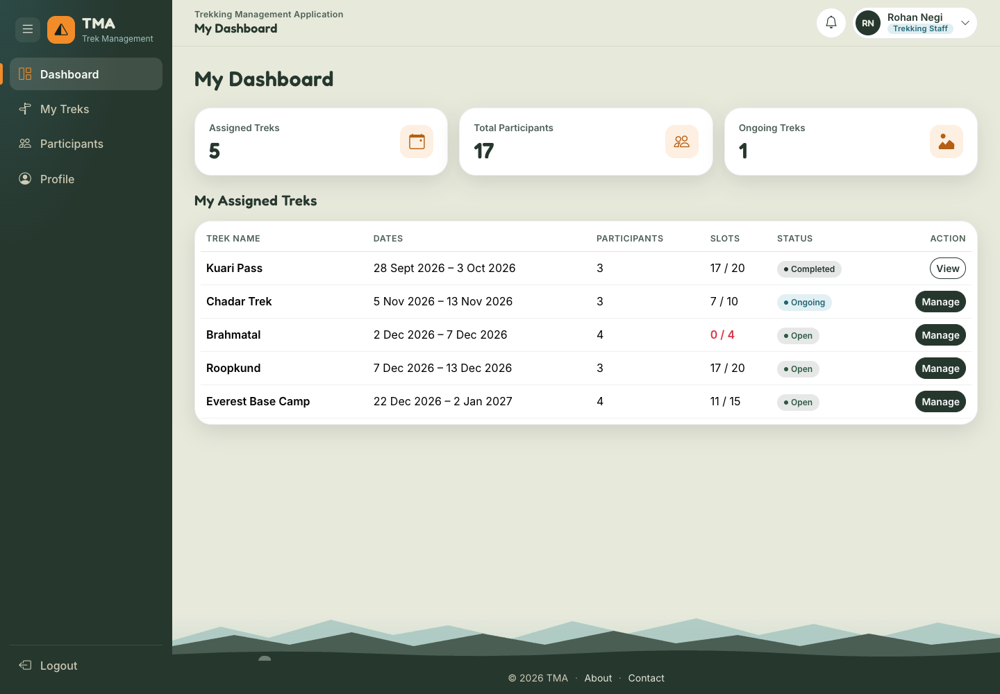 |
| **Manage trek (staff)**<br>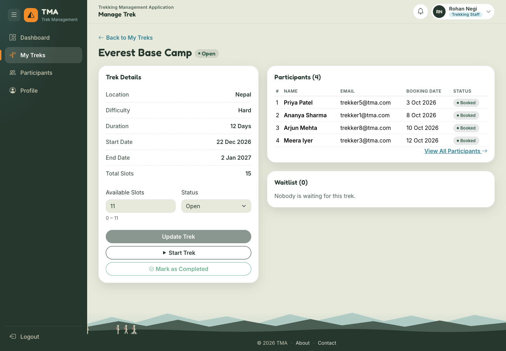 | **Trekker dashboard**<br>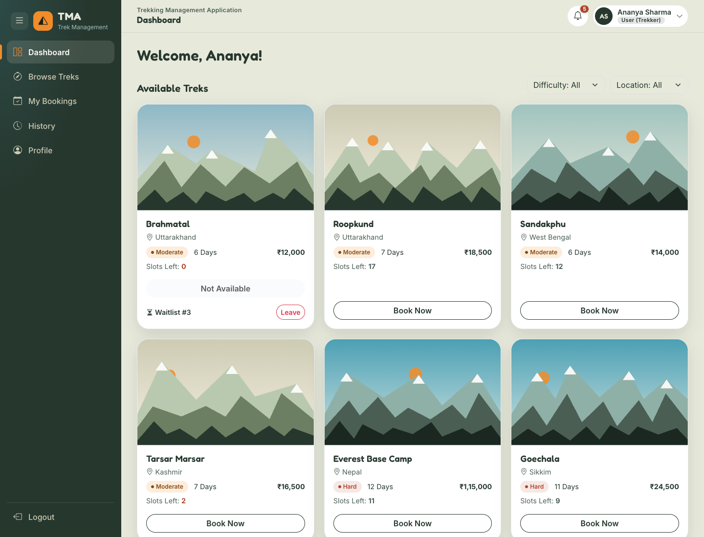 |
| **Browse treks**<br>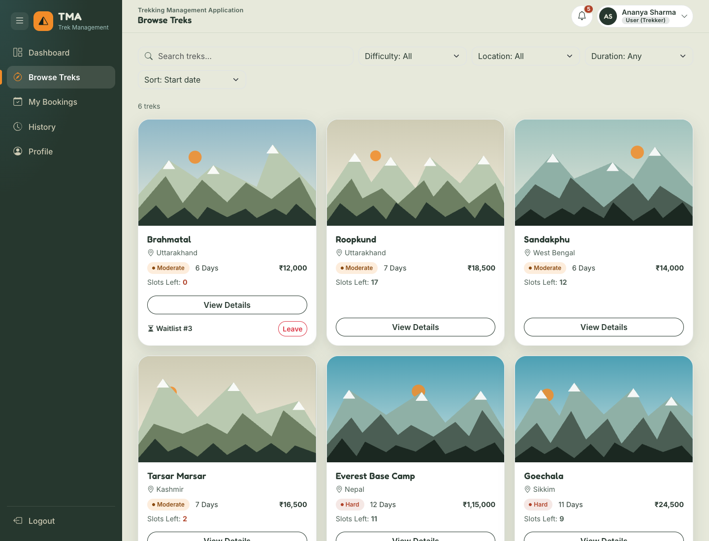 | **Trek details**<br>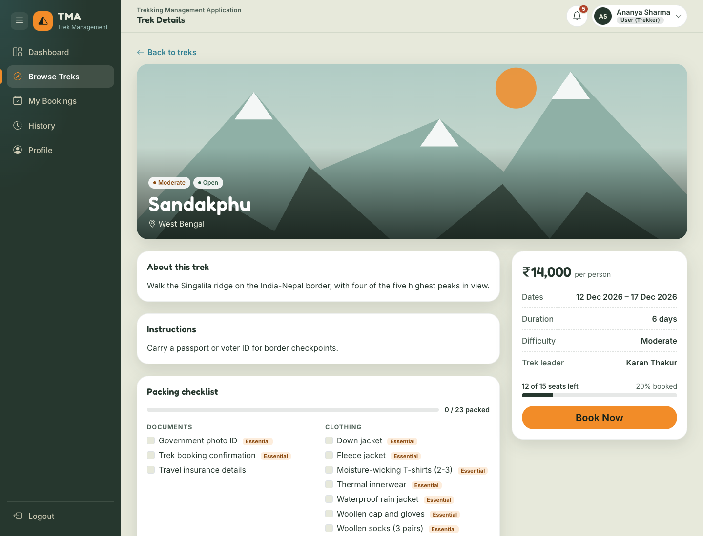 |
| **Checkout success**<br>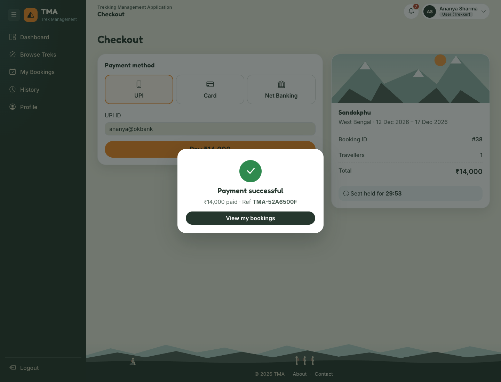 | **My bookings**<br>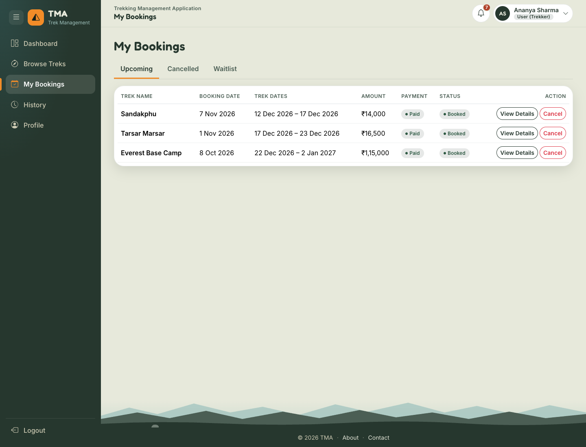 |
| **History**<br>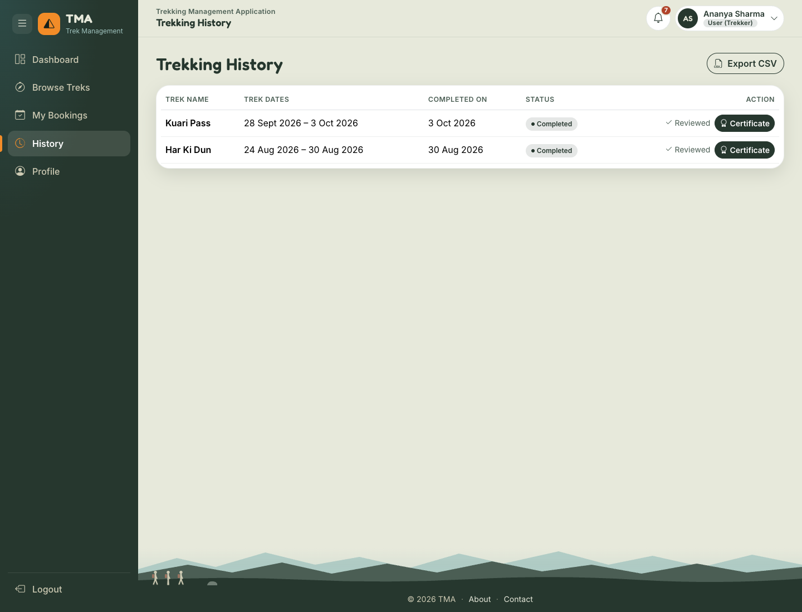 | **Certificate PDF**<br>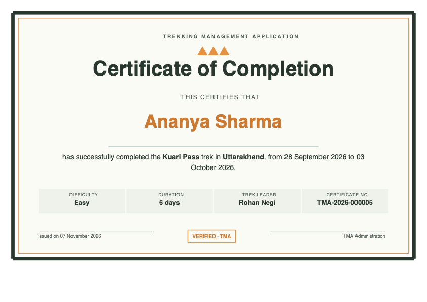 |
| **Monthly report email**<br>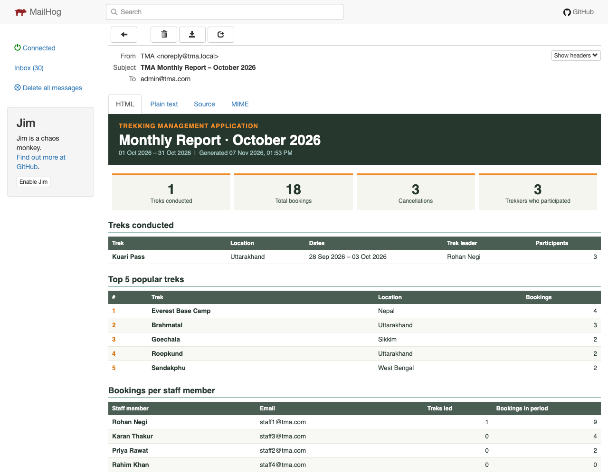 | **Phone view**<br>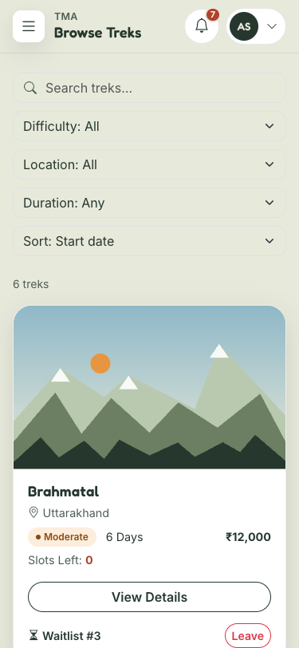 |

## Getting started (macOS)

**Prerequisites:** [Homebrew](https://brew.sh) and Python 3.12.

```bash
brew install redis mailhog

git clone <your-repo-url> tma
cd tma

python3 -m venv venv
source venv/bin/activate
pip install -r requirements.txt

cp .env.example .env
```

Open `.env` and set `SECRET_KEY`, `SECURITY_PASSWORD_SALT` and `ADMIN_PASSWORD` (use `admin123` to match the demo logins below). Generate the secrets with `python -c "import secrets; print(secrets.token_hex(32))"`.

Create the database and demo data:

```bash
python create_initial_data.py          # safe to run again: only adds what's missing
python create_initial_data.py --reset  # deletes all data and rebuilds fresh demo data
```

Then run these five commands, each in its own terminal (activate the venv in the last three):

```bash
redis-server
mailhog
python app.py
celery -A tasks.celery_app worker --loglevel=info
celery -A tasks.celery_app beat --loglevel=info
```

Open the app at <http://127.0.0.1:5001> and the MailHog inbox at <http://127.0.0.1:8025>. The app uses port 5001 because macOS AirPlay takes 5000.

## Demo logins

| Role | Email | Password |
|---|---|---|
| Admin | `admin@tma.com` | `admin123` |
| Trek staff | `staff1@tma.com` | `staff123` |
| Trekker | `trekker1@tma.com` | `user123` |

Payments are simulated. A **card number ending in 0000 is always declined**, so you can try the retry flow; any other valid number succeeds.

## Project structure

```text
.
├── app.py                    # Flask app factory, blueprints, error handlers
├── config.py                 # Settings, read from .env
├── extensions.py             # db, security, cache, mail
├── models.py                 # SQLAlchemy models (11 tables)
├── create_initial_data.py    # Tables, roles, admin and demo data (--reset)
├── routes/                   # REST API, one blueprint per area
├── utils/                    # Seat and waitlist rules, cache, validation, PDF
├── tasks/                    # Celery app, jobs, email/report/certificate templates
├── templates/index.html      # The single page that loads the Vue app
├── static/
│   ├── css/  img/  media/
│   ├── js/                   # Vue app: components/, pages/, utils/, router, store
│   ├── manifest.json
│   └── service-worker.js
└── docs/                     # API docs, ER diagram, guide, screenshots
```

## Documentation

- [API documentation](docs/api_endpoints.md): every endpoint, its role and its rules
- [ER diagram](docs/er_diagram.png) ([SVG](docs/er_diagram.svg))
- [Interview guide (PDF)](docs/TMA_Interview_Guide.pdf) ([Markdown](docs/interview_guide.md)): how every part works and why

## What I learned

- Race conditions are best solved in the database: a single conditional `UPDATE` is simpler and safer than checking in Python and then writing.
- Everything that moves a seat belongs in one place. Routes and Celery jobs share the same functions, so the rules can't drift apart.
- A cache is only as good as its key and its invalidation. Reports once ignored the selected dates because every range shared one fixed key.
- Slow work belongs in background jobs, which also means handling their failure and showing progress in the UI.
- Testing whole user journeys in a real browser finds bugs that testing endpoints alone misses.

## Future improvements

- A real payment gateway, with webhooks and real refunds
- PostgreSQL and database migrations in place of SQLite
- An automated test suite running in CI
- Real-time notifications (Server-Sent Events) instead of polling
- Ratings that carry across departures of the same trek

## Author

**Aanchal Routela**

- GitHub: [your-github-username](https://github.com/your-github-username)
- LinkedIn: [your-linkedin-profile](https://www.linkedin.com/in/your-linkedin-profile)
