# TMA Interview Guide

A study guide to the Trekking Management Application: how it works, why it was built this way, and how to explain it in an interview, viva or code review. Every file, function and endpoint named here exists in this repository.

> **How to use it:** read sections 1–3 first for the big picture. Use sections 5–12 as reference while reading the code. Practise with section 14 out loud before an interview.
# 1. Project overview

## The problem

A trekking company runs group treks in the Himalayas. Each trek has a fixed number of seats, a trek leader, a start date and an end date. Without software, the company handles bookings on phone calls and spreadsheets, which causes real problems:

- **Overbooking:** two people are promised the last seat.
- **Lost demand:** when a trek is full, interested people are turned away and forgotten.
- **Unpaid holds:** someone "reserves" a seat, never pays, and the seat sits empty.
- **No overview:** the owner can't see which treks are popular or how many people went last month.
- **Scattered communication:** trekkers don't get reminders, confirmations or certificates.

**TMA (Trekking Management Application)** solves this with one web app that has three separate areas, one per role.

## Who the users are

| Role | Who they are | How they get an account |
|---|---|---|
| **Admin** (`admin`) | The company owner or manager. There is exactly one. | Created by `create_initial_data.py` from `ADMIN_EMAIL` and `ADMIN_PASSWORD` in `.env`. |
| **Trekking Staff** (`staff`) | Trek leaders who run treks on the ground. | Created by the admin (`POST /api/admin/staff`). The login details are emailed to them. |
| **Trekker** (`user`) | Customers who book treks. | They register themselves (`POST /api/register`). |

## What each role can do

**Admin**

- Sees a dashboard with totals (treks, trekkers, staff, bookings) and the 5 most recent bookings.
- Creates, edits and deletes treks, changes their status, and assigns a trek leader.
- Adds trek-specific items to a trek's packing checklist.
- Creates staff accounts, and blacklists or whitelists any staff member or trekker.
- Sees every booking (including cancelled and completed history) and filters by status or trek.
- Searches users, staff and treks from one search box.
- Opens Reports: six charts for any date range, plus a PDF report download.
- Moderates reviews: hide, unhide or delete.
- Edits their own account and per-browser preferences (rows per page, compact sidebar) in Settings.

**Trekking Staff**

- Sees a dashboard with their assigned treks, total participants and ongoing treks.
- Opens "Manage Trek" for a trek they lead: changes the number of free seats, opens or closes it for booking, starts it and marks it completed.
- Sees the participant list and the waitlist of their treks.
- Edits their own profile (including experience and specialization).

**Trekker**

- Browses Open treks with search and filters (difficulty, location, duration, sort by date or rating).
- Opens trek details: description, instructions, packing checklist and reviews.
- Books a seat (held for 30 minutes) and pays on the checkout page (simulated UPI, card or net banking).
- Joins a waitlist when a trek is full, and is promoted automatically when a seat frees up.
- Cancels before the trek starts, and gets a recorded refund if they had paid.
- After a completed trek: writes one review, downloads a completion certificate PDF, and exports all bookings as CSV.
- Gets in-app notifications (the bell) and emails.

## Why this design solves the problem

| Problem | How TMA solves it | Where in the code |
|---|---|---|
| Overbooking | A seat is taken by one conditional SQL `UPDATE`, so two requests can never both take the last seat. | `take_one_slot()` in `utils/bookings.py` |
| Lost demand | A full trek has a waitlist. A freed seat goes to waitlist #1 in the same transaction. | `promote_from_waitlist()` in `utils/bookings.py` |
| Unpaid holds | Every booking starts as payment `Pending` with a 30-minute window. A Celery job cancels expired holds every 10 minutes. | `auto_cancel_unpaid` in `tasks/tasks.py` |
| No overview | Admin dashboard, reports with charts, a monthly PDF report emailed on the 1st. | `routes/admin_routes.py`, `monthly_report` |
| Communication | In-app notifications plus emails for confirmations, cancellations, promotions, reminders and staff accounts. | `utils/notify.py`, `send_booking_email` |
| Slow pages | Shared, read-heavy responses (trek lists, admin stats, reports) are cached in Redis. | `utils/cache.py` |


# 2. Tech stack

Versions come from `requirements.txt` and from the CDN links in `templates/index.html`.

## Backend

### Python 3.12

- **What it is:** a general-purpose programming language.
- **Used for:** the whole backend: Flask app, models, validation, Celery jobs, the seed script.
- **Why:** readable, huge ecosystem for web apps, and the language of Flask and Celery.
- **Alternative:** Node.js. Not used because the course and the chosen tools (Flask, Celery, SQLAlchemy) are Python.

### Flask 3.1.3

- **What it is:** a small ("micro") web framework. You add the parts you need.
- **Used for:** the REST API. `app.py` builds the app with `create_app()`, and each file in `routes/` is a **Blueprint** (a group of related routes), for example `admin_bp` with the prefix `/api/admin`.
- **Why:** simple to learn and explain, no hidden magic, works well as a JSON API.
- **Alternative:** Django. It has its own ORM, admin site and templates, which is a lot of structure we don't need for a JSON API with a Vue frontend.

### Flask-SQLAlchemy 3.1.1 and SQLAlchemy 2.1.6

- **What they are:** SQLAlchemy is an ORM (Object Relational Mapper): Python classes map to database tables. Flask-SQLAlchemy connects it to Flask (sessions per request, `db.Model`, `paginate()`).
- **Used for:** every table in `models.py`, every query in `routes/`, and the atomic updates in `utils/bookings.py` (`update(Trek).where(...)`).
- **Why:** we write Python instead of raw SQL most of the time, but can still write exact SQL-like statements when correctness matters.
- **Alternative:** raw `sqlite3` queries. More code, easier to make mistakes, and harder to switch databases later.

### SQLite

- **What it is:** a database stored in one file (`instance/tma.db`), with no server process.
- **Used for:** all data.
- **Why:** zero setup, perfect for a project and a demo, and it still supports transactions, foreign keys, CHECK constraints and partial indexes.
- **Alternative:** PostgreSQL. Better for many simultaneous writers and real production, but needs a server. Switching later is mainly a change of `SQLALCHEMY_DATABASE_URI` (see the scaling questions in section 14).

### Flask-Security-Too 5.9.2

- **What it is:** an authentication library for Flask (users, roles, password hashing, tokens).
- **Used for:** the user and role datastore (`SQLAlchemyUserDatastore` in `app.py`), password hashing (`hash_password`, `verify_password`), auth tokens (`user.get_auth_token()`), and the decorators `auth_required("token")` and `roles_accepted(...)` used inside our own `role_required` in `utils/decorators.py`.
- **Why:** writing secure password and token handling by hand is risky. This library is well tested.
- **Alternative:** Flask-Login plus our own JWT code. More code to write and get right ourselves.
- **Note:** its built-in HTML views are switched off (`register_blueprint=False` in `app.py`). We use our own JSON endpoints in `routes/auth_routes.py`.

### bcrypt 5.0.0

- **What it is:** a slow, salted password-hashing algorithm.
- **Used for:** storing passwords. `SECURITY_PASSWORD_HASH = "bcrypt"` in `config.py`.
- **Why:** bcrypt is deliberately slow, so guessing passwords from a stolen database is very expensive.
- **Alternative:** Argon2 (also excellent, newer). Plain SHA-256 is **not** an alternative: it is far too fast to be safe for passwords.

### Flask-Caching 2.5.1 and Redis

- **What they are:** Redis is an in-memory key-value store. Flask-Caching is a Flask wrapper with a Redis backend (`CACHE_TYPE = "RedisCache"`).
- **Used for:** caching trek lists, trek details, locations, admin stats and reports (`utils/cache.py`). Redis is also the Celery **broker** (db 1) and **result backend** (db 2).
- **Why:** Redis is very fast and can play all three roles, so there is one extra service, not three.
- **Alternative:** Memcached for the cache and RabbitMQ for the queue. That means two more services to run.

### Celery 5.6.3 and Celery Beat

- **What they are:** Celery runs Python functions ("tasks") in a separate worker process. Beat is Celery's scheduler: it puts tasks on the queue at set times.
- **Used for:** emails, the CSV export, the monthly report, daily reminders and auto-cancelling unpaid bookings (`tasks/tasks.py`, schedule in `tasks/celery_app.py`).
- **Why:** slow work (sending email, building a PDF) must not make the user wait for an HTTP response.
- **Alternative:** RQ (simpler, but no built-in scheduler) or cron jobs (no queue, no task status for the UI).

### Flask-Mail 0.10.0 and MailHog

- **What they are:** Flask-Mail sends email over SMTP. MailHog is a fake SMTP server for development: it catches every email and shows it in a web inbox at `http://127.0.0.1:8025`.
- **Used for:** `send_email()` in `tasks/mailer.py`. Locally, `MAIL_SERVER=localhost` and `MAIL_PORT=1025` point at MailHog.
- **Why:** we can test real emails without sending anything to real people. Switching to Gmail or another SMTP server is only a change in `.env`.
- **Alternative:** printing emails to the console. That doesn't show how the HTML email really looks.

### xhtml2pdf 0.2.28

- **What it is:** converts HTML and simple CSS into a PDF, in pure Python.
- **Used for:** `html_to_pdf()` in `utils/pdf.py`, which creates the completion certificate (`tasks/templates/certificate.html`) and the monthly and date-range report (`tasks/templates/monthly_report.html`).
- **Why:** no browser or system library is needed, so it runs inside the Celery worker and the API.
- **Alternative:** WeasyPrint (better CSS support but needs system libraries) or headless Chrome (very good output but heavy). Our templates use tables because xhtml2pdf doesn't support flexbox or CSS variables.

### python-dotenv 1.2.4

- **What it is:** loads `KEY=value` lines from a `.env` file into environment variables.
- **Used for:** `config.py` calls `load_dotenv()`. Secrets (`SECRET_KEY`, `SECURITY_PASSWORD_SALT`) have no defaults: `required_env()` raises an error if they are missing.
- **Why:** secrets stay out of the code and out of git (`.env` is in `.gitignore`).
- **Alternative:** exporting variables in the shell by hand every time.

### Jinja2 3.1.6

- **What it is:** a template engine: HTML with `{{ placeholders }}`, loops and conditions.
- **Used for:** two things. Flask renders `templates/index.html` (the only server-rendered page). `tasks/mailer.py` has its own Jinja `Environment` with autoescaping for the email, certificate and report templates in `tasks/templates/`.
- **Why:** it comes with Flask, and autoescaping stops HTML injection from names that users type.
- **Alternative:** building HTML strings by hand. That is unsafe and hard to read.

## Frontend

### JavaScript (ES modules)

- **What it is:** the language of the browser. ES modules use `import` and `export`.
- **Used for:** the whole frontend in `static/js/`.
- **Why:** modules work natively in modern browsers, so there is **no build step** (no webpack or Vite).
- **Alternative:** TypeScript with a bundler. Type safety, but a build step adds complexity a viva doesn't need.

### Vue 3 (3.5.13) and Vue Router (4.5.0)

- **What they are:** Vue is a reactive UI framework: when data changes, the page updates. Vue Router maps URLs to page components.
- **Used for:** every page and component. Components use the **Options API** (`data`, `computed`, `methods`, `template`). The router uses **hash mode** (`/#/admin/treks`), so Flask only ever serves `/`.
- **Loaded how:** from unpkg through an **import map** in `templates/index.html`, so files can write `import { createApp } from 'vue'`.
- **Why:** easy to learn, and the template strings read like HTML.
- **Alternative:** React. Similar power, but JSX needs a build step, and the project required Vue.

### Bootstrap 5 (5.3.3) and Bootstrap Icons (1.11.3)

- **What they are:** a CSS framework (grid, buttons, forms, tables, dropdowns) and an icon font.
- **Used for:** layout and components everywhere, the user menu dropdown (`data-bs-toggle="dropdown"` in `Navbar.js`), and icons like `bi-bell`. Our theme overrides Bootstrap's CSS variables in `static/css/theme.css` (for example `--bs-primary: var(--forest)`).
- **Why:** responsive layout and accessible components with little CSS.
- **Alternative:** Tailwind CSS. Needs a build step to strip unused classes.

### Chart.js 4.4.1

- **What it is:** a charting library that draws on a `<canvas>`.
- **Used for:** the six report charts in `static/js/components/ChartCard.js`. It is loaded from the CDN only the first time a chart is shown (`loadChartJs()`), so other pages never download it.
- **Why:** small, simple API, good defaults, responsive.
- **Alternative:** D3.js. Much more flexible but far more code for basic charts.

### HTML5, CSS3, Canvas API and SVG

- **HTML5:** semantic elements (`<main>`, `<nav>`, `<aside>`), `<video>` for the login intro, form inputs like `type="date"` and `type="month"`.
- **CSS3:** custom properties (design tokens in `theme.css`), flexbox and grid, `@keyframes` animations, `perspective` for the 3D tilt, `offset-path` (the loader's hiker follows an SVG path), media queries, and `prefers-reduced-motion`.
- **Canvas API:** a 2D drawing surface controlled by JavaScript. Used by `ParticleLayer.js` (floating lights), `confettiBurst()` in `utils/motion.js`, and Chart.js.
- **SVG:** vector graphics in markup. Used by `TrekImage.js` (a generated mountain picture per trek), `TrekkerFooter.js` (animated hikers), `EmptyState.js`, `Loader.js` and `NotFound.js`.
- **Alternatives:** image files instead of SVG (heavier, not themeable); an animation library like GSAP (not needed for these effects).

### Service workers and PWA

- **What it is:** a Progressive Web App is a website that can be installed like an app. A **service worker** is a script that runs between the page and the network and can serve files from a cache.
- **Used for:** `static/manifest.json` (name, icons, colours), `static/service-worker.js` (caches the app shell), `routes/pwa_routes.py` (serves the worker from the site root), and `InstallPrompt.js` (the "Install app" menu item).
- **Why:** faster loads, installable on phones and desktops, and the shell opens even offline.
- **Alternative:** a native app. Much more work and two separate codebases.

## Tooling

### Git

- **What it is:** version control: a history of every change.
- **Used for:** the project history, one commit per phase (for example "Add Redis caching for trek listings with invalidation"). `.gitignore` keeps `venv/`, `instance/`, `*.db`, `.env`, `static/exports/`, `__pycache__/` and `celerybeat-schedule*` out of the repository.
- **Why:** you can go back to any version, see what changed, and share the code on GitHub.
- **Alternative:** Mercurial or SVN. Git is the industry standard.

# 3. Architecture

## The whole system

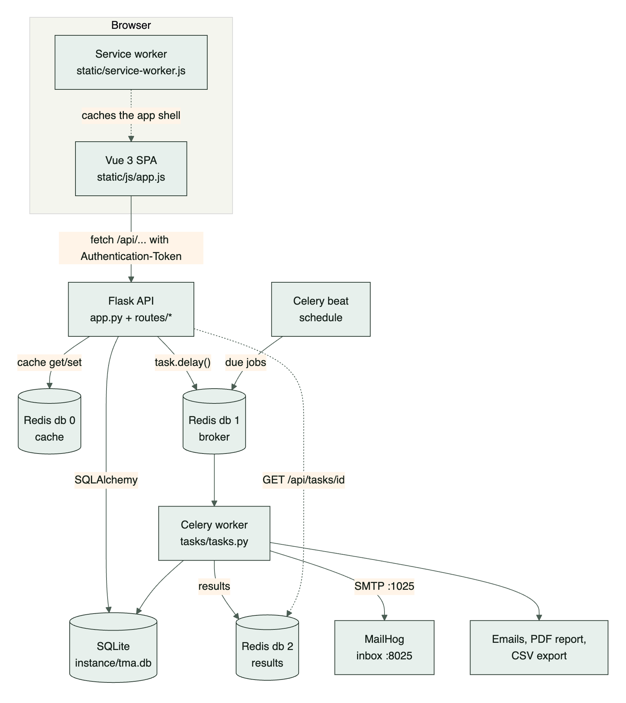

There are six running pieces:

1. **The browser** loads one HTML page (`templates/index.html`), then the Vue app (`static/js/app.js`) takes over. A service worker caches the app's files.
2. **The Flask API** (`python app.py`, port 5001) answers JSON requests under `/api/...`.
3. **SQLite** (`instance/tma.db`) stores everything.
4. **Redis** holds three different things in three numbered databases: the cache (db 0), the Celery job queue (db 1) and Celery job results (db 2).
5. **The Celery worker** runs jobs (emails, PDF, CSV). **Celery beat** adds scheduled jobs to the queue.
6. **MailHog** receives every email and shows it in a web inbox.

## Request lifecycle: from "Book Now" to the email

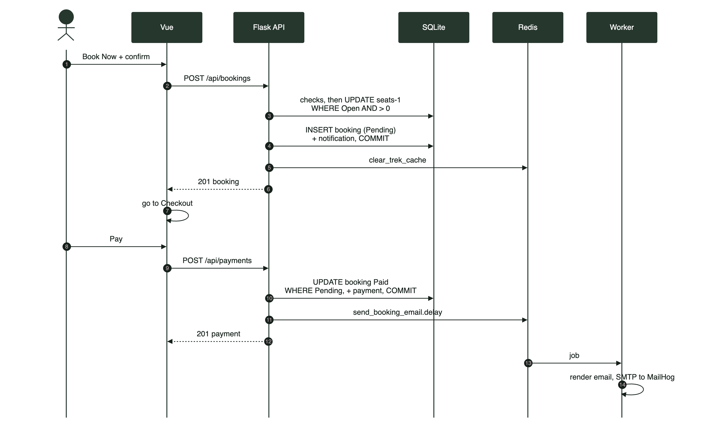

Booking and paying are two separate steps. The email is sent after payment, not after booking.

**Step 1: the click.** On the trek details page (`TrekDetails.js`) the trekker clicks **Book Now**. The page calls `startBooking()` in `static/js/utils/booking.js`, which shows a confirm dialog ("We'll hold your seat for 30 minutes while you pay").

**Step 2: the request.** `post('/bookings', { trek_id })` in `static/js/api.js` sends `POST /api/bookings` with the `Authentication-Token` header.

**Step 3: authentication.** The route `create_booking()` in `routes/booking_routes.py` is protected by `@role_required(ROLE_USER)`. It checks the token (401 if missing or invalid), the blacklist (403) and the role (403).

**Step 4: the checks**, in this order: valid `trek_id` (400) → trek exists (404) → trek is `Open` (400) → user not blacklisted (403) → no active booking already (409).

**Step 5: take a seat atomically.** `take_one_slot(trek.id)` runs a single statement:

```sql
UPDATE trek SET available_slots = available_slots - 1
WHERE id = :id AND status = 'Open' AND available_slots > 0
```

If no row matched, the trek is full: the session is rolled back and the API answers 409.

**Step 6: save.** A `Booking` row is added (`status="Booked"`, `payment_status="Pending"`, `amount=trek.price`) plus a "Seat held" notification. One `db.session.commit()` saves the seat decrement, the booking and the notification **together**.

**Step 7: cache.** `clear_trek_cache(trek.id)` deletes cached trek lists, this trek's details, locations and admin data, because the seat count changed.

**Step 8: the response.** `201` with the booking. The frontend shows a toast and navigates to `/user/checkout/<booking_id>`.

**Step 9: checkout.** `Checkout.js` loads `GET /api/user/bookings/<id>` and shows a countdown to `payment_due_at` (booking time + 30 minutes). The trekker picks UPI, Card or Net Banking and clicks **Pay**.

**Step 10: payment.** `POST /api/payments` runs `pay()` in `routes/payment_routes.py`. After its checks it waits `PAYMENT_SIMULATION_SECONDS` (1 second, to feel like a bank), then runs another conditional update:

```python
update(Booking)
.where(Booking.id == booking.id, Booking.status == "Booked", Booking.payment_status == "Pending")
.values(payment_status="Paid")
```

It adds a `Payment` row (`status="Success"`, a random `transaction_ref` like `TMA-8F3A21C9`) and a "Payment successful" notification, then commits.

**Step 11: queue the email.** `enqueue_quietly(send_booking_email, booking.id, "confirmed")` puts a message on the Redis queue and returns immediately. The API answers `201`, and the page shows "Payment successful".

**Step 12: the worker.** The Celery worker picks up the job, renders `tasks/templates/booking_email.html` and sends it over SMTP to MailHog. The bell's next poll (or the `tma:data-changed` event fired by `api.js` after any booking or payment call) refreshes the unread count.

## Why an SPA with a REST API?

An **SPA (single-page application)** loads one HTML page and then swaps content with JavaScript. A **REST API** returns data (JSON), not pages.

- **Clear separation:** Flask only deals with data and rules. Vue only deals with the screen. Each side can be tested and changed on its own.
- **One API, many clients:** the same endpoints could serve a mobile app later.
- **Smooth UI:** no full page reload on every click, which allows animations, toasts, live countdowns and the polling bell.
- **PWA:** an installable, offline-capable app needs a client-side app shell.

**Why is Jinja used only for `index.html`?** All pages are Vue components, so the server never builds page HTML. `index.html` is the one page Flask serves (route `/` in `app.py`): it only loads CSS, the import map and `app.js`. Jinja is still used, separately, for emails and PDFs, because those are generated on the server.

# 4. Folder structure

Every file in the project, with one line each. (`venv/`, `instance/`, `__pycache__/` and `.git/` are not part of the code.)

```text
BasecampX/
├── .env                      Your local secrets and settings (never committed)
├── .env.example              Every setting with placeholders; copy to .env
├── .gitignore                What git ignores (venv, database, .env...)
├── README.md                 Project page for GitHub
├── requirements.txt          The 14 Python packages the app imports, pinned
├── app.py                    create_app(): extensions, blueprints, errors; port 5001
├── config.py                 Config: database, security, cache, mail, Celery (from .env)
├── extensions.py             db, cache, mail, security (no app yet); SQLite FKs on
├── models.py                 All 11 tables as models, allowed values, to_dict()
├── create_initial_data.py    Tables, roles, admin, demo data; --reset rebuilds all
├── docs/
│   ├── api_endpoints.md      Every API endpoint, its role and rules
│   ├── er.dot                ER diagram source (Graphviz), generated from models
│   ├── er_diagram.png        ER diagram image
│   ├── er_diagram.svg        ER diagram as a vector image
│   ├── wireframe.png         The original wireframe the UI follows
│   ├── interview_guide.md    This guide (source)
│   ├── TMA_Interview_Guide.pdf  This guide as a PDF
│   ├── diagrams/             8 architecture and flow diagrams for this guide
│   └── screenshots/          16 screenshots for the README and this guide
├── routes/
│   ├── __init__.py           Empty: marks the folder as a Python package
│   ├── auth_routes.py        register, login, logout, me, profile
│   ├── admin_routes.py       /api/admin: stats, treks, staff, users, reports, jobs...
│   ├── booking_routes.py     Hold a seat, cancel a booking
│   ├── payment_routes.py     Simulated payment; card ending 0000 is declined
│   ├── waitlist_routes.py    Join/leave, my waitlist, staff view
│   ├── trek_routes.py        Browse, details, locations, checklist (cached)
│   ├── user_routes.py        /api/user: bookings, history, export, certificate
│   ├── staff_routes.py       /api/staff: dashboard, treks, update, start, complete
│   ├── review_routes.py      Write, list, moderate reviews
│   ├── notification_routes.py  List, unread count, mark read
│   ├── task_routes.py        Job status, protected CSV download
│   └── pwa_routes.py         Serves /service-worker.js from the site root
├── utils/
│   ├── __init__.py           Empty: marks the folder as a Python package
│   ├── bookings.py           Seat + waitlist rules: take, give back, promote, cancel
│   ├── cache.py              Redis cache helpers, X-Cache, invalidation
│   ├── decorators.py         role_required, token_required, json_error
│   ├── jobs.py               enqueue() (503 if Redis down), enqueue_quietly()
│   ├── notify.py             notify(), notify_many(): in-app notifications
│   ├── pagination.py         paginate(): ?page=&per_page= -> {items, total...}
│   ├── pdf.py                html_to_pdf() with xhtml2pdf
│   ├── profile.py            update_profile(): name, phone, password
│   └── validators.py         Validation for every body and query parameter
├── tasks/
│   ├── __init__.py           Empty: marks the folder as a Python package
│   ├── celery_app.py         Celery app, settings, beat schedule
│   ├── tasks.py              The 6 jobs and the report builders
│   ├── mailer.py             render() templates, send_email()
│   └── templates/
│       ├── base_email.html         Shared email layout (header, footer)
│       ├── booking_email.html      Booking confirmed / cancelled / promoted
│       ├── reminder_email.html     "Your trek starts in N days" + what to carry
│       ├── staff_welcome_email.html  Login details for new staff
│       ├── export_ready_email.html   "Your export is ready" (CSV attached)
│       ├── monthly_report.html     Monthly / date-range report (email + PDF)
│       └── certificate.html        The completion certificate (PDF)
├── templates/
│   └── index.html            The one HTML page: CSS, import map, app.js, SW
└── static/
    ├── manifest.json         PWA manifest: name, colours, icons
    ├── service-worker.js     Caches the app shell; never /api
    ├── css/
    │   ├── theme.css         Design tokens, Bootstrap overrides, keyframes
    │   ├── auth.css          Login/register: video, clouds, glass card, tilt
    │   └── style.css         Layout, sidebar, tables, cards, charts, footer, pages
    ├── img/
    │   ├── login-bg-end.jpg  Last frame of the login video
    │   ├── icons/            PWA icons (192, 512, maskable, Apple touch)
    │   └── treks/            Empty; suggested place for trek photos
    ├── media/
    │   └── login-bg.mp4      The login intro video
    ├── exports/              CSV exports (served only via /api/exports/<file>)
    └── js/
        ├── app.js            Creates the Vue app with router, toasts, dialog
        ├── router.js         All routes and the role guard
        ├── api.js            fetch wrapper: token, errors, 401, downloads
        ├── store.js          Shared state: who is logged in, preferences
        ├── utils/
        │   ├── booking.js    startBooking(): confirm, book, go to checkout
        │   ├── constants.js  Difficulties, statuses, duration filters
        │   ├── format.js     Dates, money (₹), "5 min ago", badges
        │   ├── motion.js     Reduced motion, typewriter, ripple, confetti
        │   └── waitlist.js   myTreks, joinWaitlist(), leaveWaitlist()
        ├── components/       26 reusable components (section 11)
        └── pages/
            ├── Login.js, Register.js, NotFound.js
            ├── admin/        AdminDashboard, ManageTreks, TrekForm,
            │                 ManageStaff, CreateStaff, ManageUsers,
            │                 AllBookings, AdminSearch, Reports,
            │                 ManageReviews, Settings
            ├── staff/        StaffDashboard, MyTreks, ManageTrek,
            │                 Participants, StaffProfile
            └── user/         UserDashboard, BrowseTreks, TrekDetails,
                              Checkout, MyBookings, History, Profile
```


# 5. Database

## The ER diagram

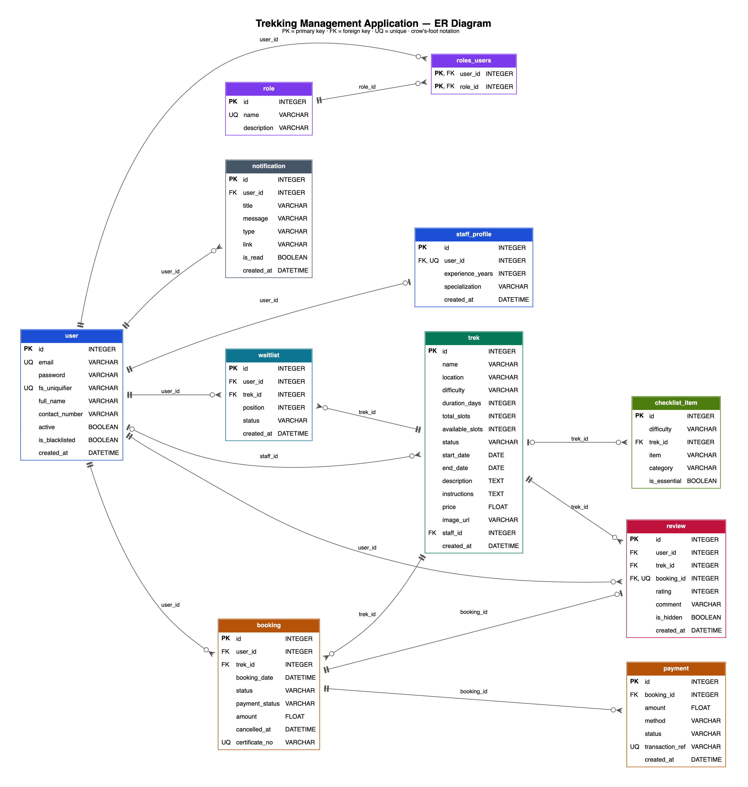

There are **11 tables**. `roles_users` is a link table. The other ten are SQLAlchemy model classes in `models.py`.

A few rules apply to the whole schema:

- **CHECK constraints** make the database itself reject wrong values. `_in_list("status", TREK_STATUSES)` creates `CHECK (status IN ('Pending', 'Approved', ...))`. Even a bug in Python can't save `status = 'Opne'`.
- **Foreign keys are enforced.** SQLite ignores foreign keys unless you switch them on for every connection, so `extensions.py` runs `PRAGMA foreign_keys=ON` in an `@event.listens_for(Engine, "connect")` hook.
- **Times are stored in UTC** without a timezone (SQLite has no timezone type). `iso()` in `models.py` adds a `Z` when sending them as JSON, so the browser shows the correct Indian time. Without the `Z`, times would be 5.5 hours off.
- **Every model has `to_dict()`** for JSON. Secrets (`password`, `fs_uniquifier`) are never included.

## Every table and column

### `role`
| Column | Type | Constraints | Why |
|---|---|---|---|
| id | INTEGER | PK | |
| name | VARCHAR(50) | UNIQUE, NOT NULL | `admin`, `staff` or `user` |
| description | VARCHAR(255) | | Human-readable text, e.g. "Trek leader / staff" |

### `user`
| Column | Type | Constraints | Why |
|---|---|---|---|
| id | INTEGER | PK | |
| email | VARCHAR(255) | UNIQUE, NOT NULL | Login name; stored lower-case by `clean_email()` |
| password | VARCHAR(255) | NOT NULL | bcrypt hash, never plain text |
| fs_uniquifier | VARCHAR(64) | UNIQUE, NOT NULL | Random value baked into every token. Changing it logs the user out everywhere. |
| full_name | VARCHAR(120) | | Shown in the UI and on certificates |
| contact_number | VARCHAR(20) | | 10–15 digits |
| active | BOOLEAN | NOT NULL, default true | Flask-Security's "account enabled" flag |
| is_blacklisted | BOOLEAN | NOT NULL, default false | Our own ban flag, checked on every request |
| created_at | DATETIME | NOT NULL | When the account was made |

### `roles_users` (link table)
| Column | Type | Constraints | Why |
|---|---|---|---|
| user_id | INTEGER | PK, FK → user.id | |
| role_id | INTEGER | PK, FK → role.id | The composite primary key stops the same role being given twice |

### `staff_profile`
| Column | Type | Constraints | Why |
|---|---|---|---|
| id | INTEGER | PK | |
| user_id | INTEGER | FK → user.id, UNIQUE, NOT NULL | UNIQUE makes it one-to-one: one profile per user |
| experience_years | INTEGER | default 0 | Years as a trek leader |
| specialization | VARCHAR(120) | | e.g. "Winter & snow treks" |
| created_at | DATETIME | NOT NULL | |

### `trek`
| Column | Type | Constraints | Why |
|---|---|---|---|
| id | INTEGER | PK | |
| name | VARCHAR(120) | NOT NULL | |
| location | VARCHAR(120) | NOT NULL | Used by the location filter |
| difficulty | VARCHAR(20) | NOT NULL, CHECK Easy/Moderate/Hard | Filter, and picks the default packing list |
| duration_days | INTEGER | NOT NULL | Duration filter (`min_days`, `max_days`) |
| total_slots | INTEGER | NOT NULL | Capacity of the trek |
| available_slots | INTEGER | NOT NULL | Seats still free right now |
| status | VARCHAR(20) | NOT NULL, CHECK, default Pending | Lifecycle (see section 8) |
| start_date, end_date | DATE | | Trek dates |
| description, instructions | TEXT | | Shown on the details page; instructions also go into the reminder email |
| price | FLOAT | NOT NULL, default 0 | Per person, in rupees |
| image_url | VARCHAR(500) | | Optional photo; without it `TrekImage.js` draws a mountain |
| staff_id | INTEGER | FK → user.id, nullable | The trek leader; empty until the admin assigns one |
| created_at | DATETIME | NOT NULL | |

### `booking`
| Column | Type | Constraints | Why |
|---|---|---|---|
| id | INTEGER | PK | |
| user_id | INTEGER | FK → user.id, NOT NULL | Who booked |
| trek_id | INTEGER | FK → trek.id, NOT NULL | Which trek |
| booking_date | DATETIME | NOT NULL | Also the start of the 30-minute payment window |
| status | VARCHAR(20) | CHECK Booked/Cancelled/Completed | |
| payment_status | VARCHAR(20) | CHECK Pending/Paid/Refunded | |
| amount | FLOAT | NOT NULL | The price at booking time (prices can change later) |
| cancelled_at | DATETIME | nullable | When it was cancelled (used by reports) |
| certificate_no | VARCHAR(30) | UNIQUE, nullable | Issued on the first certificate download, e.g. `TMA-2026-000005` |

Plus a **partial unique index** `uq_one_active_booking` on `(user_id, trek_id)` **where `status = 'Booked'`**.

### `payment`
| Column | Type | Constraints | Why |
|---|---|---|---|
| id | INTEGER | PK | |
| booking_id | INTEGER | FK → booking.id, NOT NULL, indexed | One booking can have many attempts |
| amount | FLOAT | NOT NULL | |
| method | VARCHAR(20) | CHECK UPI/Card/NetBanking | |
| status | VARCHAR(20) | CHECK Success/Failed/Refunded | Failed attempts and refunds are kept as history |
| transaction_ref | VARCHAR(20) | UNIQUE, NOT NULL | Random reference from `_ref()`, e.g. `TMA-8F3A21C9` |
| created_at | DATETIME | NOT NULL | |

### `waitlist`
| Column | Type | Constraints | Why |
|---|---|---|---|
| id | INTEGER | PK | Also the joining order |
| user_id | INTEGER | FK → user.id, NOT NULL | |
| trek_id | INTEGER | FK → trek.id, NOT NULL, indexed | |
| position | INTEGER | NOT NULL | 1, 2, 3... among people still waiting |
| status | VARCHAR(20) | CHECK Waiting/Promoted/Left | |
| created_at | DATETIME | NOT NULL | When they joined |

Plus a partial unique index `uq_one_waiting_entry` on `(user_id, trek_id)` where `status = 'Waiting'`: at most one waiting entry per person per trek.

### `review`
| Column | Type | Constraints | Why |
|---|---|---|---|
| id | INTEGER | PK | |
| user_id | INTEGER | FK → user.id | Author |
| trek_id | INTEGER | FK → trek.id, indexed | For the trek's average |
| booking_id | INTEGER | FK → booking.id, UNIQUE | One review per booking, enforced by the database |
| rating | INTEGER | CHECK 1–5 | |
| comment | VARCHAR(500) | | Optional |
| is_hidden | BOOLEAN | default false | Hidden by the admin; excluded from averages |
| created_at | DATETIME | | |

### `notification`
| Column | Type | Constraints | Why |
|---|---|---|---|
| id | INTEGER | PK | |
| user_id | INTEGER | FK → user.id | Whose bell it appears in |
| title, message | VARCHAR | NOT NULL | |
| type | VARCHAR(20) | CHECK booking/payment/waitlist/trek/system | Picks the icon in the bell |
| link | VARCHAR(255) | | Frontend route to open, e.g. `/user/bookings` |
| is_read | BOOLEAN | default false | |
| created_at | DATETIME | | |

Index `ix_notification_user_unread` on `(user_id, is_read)` makes the unread count (polled every 30 seconds) fast.

### `checklist_item`
| Column | Type | Constraints | Why |
|---|---|---|---|
| id | INTEGER | PK | |
| difficulty | VARCHAR(20) | nullable | A default item for every trek of this difficulty |
| trek_id | INTEGER | FK → trek.id, nullable | Or an extra item for one trek |
| item | VARCHAR(150) | NOT NULL | e.g. "Microspikes" |
| category | VARCHAR(20) | CHECK Documents/Clothing/Gear/Health | |
| is_essential | BOOLEAN | default false | Shown with an "Essential" badge |

`CHECK (difficulty IS NOT NULL OR trek_id IS NOT NULL)` means every item belongs to something.

## Relationships

| Relationship | Type | How it's coded |
|---|---|---|
| user ↔ role | Many-to-many | `roles = db.relationship("Role", secondary=roles_users, backref="users")` |
| user → staff_profile | One-to-one | `StaffProfile.user_id` is `unique=True`; `User.staff_profile` has `uselist=False` and `cascade="all, delete-orphan"` |
| user (staff) → trek | One-to-many, optional | `Trek.staff_id` FK (nullable) ↔ `User.assigned_treks` with `back_populates="staff"` |
| user → booking | One-to-many | `Booking.user_id` ↔ `User.bookings` |
| trek → booking | One-to-many | `Booking.trek_id` ↔ `Trek.bookings` |
| booking → payment | One-to-many | `Booking.payments` ordered by `Payment.created_at` |
| booking → review | One-to-one | `Review.booking_id` is unique; `Booking.review` has `uselist=False` |
| trek → review, user → review | One-to-many | `Trek.reviews`; `Review.user` (one direction only) |
| trek → waitlist, user → waitlist | One-to-many | `Trek.waitlist` with `cascade="all, delete-orphan"`; `Waitlist.user` |
| trek → checklist_item | One-to-many | `Trek.checklist_items` with `cascade="all, delete-orphan"` |
| user → notification | One-to-many | Only the FK `Notification.user_id`; queries filter by it |

**`back_populates`** connects two sides of the same relationship, so `trek.staff` and `user.assigned_treks` stay in sync. **`cascade="all, delete-orphan"`** means "delete these children with the parent": a deleted trek takes its waitlist and trek-specific checklist items with it.

## Design decisions

**One `user` table with roles, not three tables.** Admin, staff and trekkers all log in the same way, so they share one table, and Flask-Security's `roles` decide what they can do. Staff-only fields live in `staff_profile`, so the `user` table has no columns that are empty for most people. One login endpoint works for everybody.

**`trek.staff_id` points to `user`.** A trek leader *is* a user with the `staff` role. `assign_staff()` in `admin_routes.py` checks that the chosen user has the staff role, isn't blacklisted and is active.

**Bookings are never deleted.** Cancelling only changes the status to `Cancelled` and sets `cancelled_at`. This keeps a full history of payments, refunds and demand for the admin and the reports. For the same reason `delete_trek()` refuses (409) to delete a trek that has any bookings: close it instead.

**Why no unique constraint on `(user_id, trek_id)`?** A trekker who cancelled must be allowed to book the same trek again, which creates a second row for the same pair. A plain unique constraint would block that. What we really want is "at most one **active** booking per person per trek", so we use a **partial** unique index that only covers rows where `status = 'Booked'`. The route also checks this first, so users get a clear message. The index is the safety net if two requests arrive at the same moment.

**`total_slots` vs `available_slots`.** `total_slots` is the capacity. `available_slots` is what's free right now. We store the free count instead of counting bookings on every request because:

- it makes the atomic check possible: `WHERE available_slots > 0` in one `UPDATE`;
- browsing is fast (no `COUNT` per trek);
- staff can deliberately hold back seats (set fewer free seats than capacity minus bookings).

The rules: booking does −1, cancelling does +1 but never above `total_slots` (`give_back_one_slot()`), and when the admin changes `total_slots` from 20 to 25, the free seats shift by +5 as well.

**`amount` is copied into the booking.** If the admin changes the trek price later, old bookings and refunds still show what the person actually paid.

# 6. Backend, file by file

## `app.py`: the app factory

An **app factory** is a function that builds and returns the Flask app, instead of creating it at import time.

```python
def create_app():
    app = Flask(__name__)
    app.config.from_object(Config)
    os.makedirs(os.path.join(app.root_path, "instance"), exist_ok=True)

    db.init_app(app)
    cache.init_app(app)
    mail.init_app(app)

    from models import Role, User
    user_datastore = SQLAlchemyUserDatastore(db, User, Role)
    security.init_app(app, user_datastore, register_blueprint=False)
    register_auth_error_handlers()

    from routes.admin_routes import admin_bp
    # ... 11 more blueprints
    app.register_blueprint(admin_bp)
```

Line by line:

- `app.config.from_object(Config)` copies every UPPER_CASE attribute of `Config` into the app.
- `init_app(app)` attaches extensions that were created earlier, without an app, in `extensions.py`.
- `register_blueprint=False` turns off Flask-Security's own HTML pages. Our JSON routes replace them.
- Models and blueprints are imported **inside** the function. This avoids circular imports: route files import `extensions`, and nothing imports `app.py` except the entry points.

Three more things are set up here:

- `protect_exports()`, a `before_request` hook, returns 404 for any `/static/exports/...` URL. CSV files can only be downloaded through `/api/exports/<file>`, which checks the owner.
- `register_auth_error_handlers()` makes Flask-Security answer **JSON** 401 and 403 instead of redirecting to a login page.
- `register_api_error_handlers()` turns every error under `/api` (404, 405, 500...) into `{"message": ...}`. An unexpected exception is logged and returns "Internal server error." without leaking details.

`app.run(debug=True, port=5001)`: port 5001, because on macOS the AirPlay Receiver already uses port 5000 and answers with 403 Forbidden.

## `config.py`

One `Config` class. Important values:

- `SECRET_KEY = required_env("SECRET_KEY")`: signs the auth tokens. `required_env()` raises `RuntimeError("SECRET_KEY is not set. Copy .env.example to .env and fill it in.")` if it's missing, so the app can't start with a weak default.
- `SECURITY_PASSWORD_SALT`: required too. Flask-Security mixes it into password hashing.
- `SECURITY_TOKEN_AUTHENTICATION_HEADER = "Authentication-Token"` and `SECURITY_TOKEN_MAX_AGE = 60 * 60 * 24` (tokens expire after 24 hours).
- `WTF_CSRF_ENABLED = False`: the API uses a token header, not cookies (see section 7).
- Cache: `CACHE_TYPE = "RedisCache"`, `CACHE_KEY_PREFIX = "tma:"`, socket timeouts of 0.5 s so a dead Redis fails fast, and the TTLs `CACHE_TTL_TREKS = 300`, `CACHE_TTL_LOCATIONS = 1800`, `CACHE_TTL_ADMIN = 120`.
- Mail, Celery URLs, `EXPORT_DIR`, `GCHAT_WEBHOOK_URL`, `APP_BASE_URL` (links inside emails), `REMINDER_DAYS_AHEAD = 3` and `PAYMENT_SIMULATION_SECONDS`.

## `extensions.py`: avoiding circular imports

```python
db = SQLAlchemy()
cache = Cache()
mail = Mail()
security = Security()
```

**The problem it solves:** `app.py` imports the routes, and the routes need `db`. If `db` lived in `app.py`, the routes would import `app.py`, which imports the routes: a **circular import**, and Python fails. So the extension objects are created here, with no app, and every file does `from extensions import db`. `create_app()` connects them later with `init_app()`.

The same file switches on SQLite foreign keys for every new connection.

## `models.py`

Covered in section 5. Two methods are worth knowing:

```python
def start_on(self, day):
    """The trek really starts on `day`: an early start moves both dates, same length."""
    if self.start_date > day:
        self.end_date = day + (self.end_date - self.start_date)
        self.start_date = day

def finish_on(self, day):
    """The trek really ended on `day`, so a Completed trek never ends in the future."""
    self.start_date = min(self.start_date, day)
    self.end_date = day
    self.duration_days = (self.end_date - self.start_date).days + 1
```

When staff start or complete a trek earlier than planned, these keep the dates honest: an Ongoing trek's dates always include today, and a Completed trek never ends in the future.

`Booking.payment_due_at` is a **property** (calculated, not stored): `booking_date + 30 minutes`, but only while the booking is `Booked` and `Pending`.

## `create_initial_data.py`

Run with `python create_initial_data.py`. It is **idempotent** (safe to run many times): everything is looked up first and only created if missing.

1. `upgrade_schema()` adds the `booking.certificate_no` column to databases made before Phase 8, then `db.create_all()` creates any missing tables.
2. Roles `admin`, `staff` and `user` (`find_or_create_role`).
3. The admin, from `ADMIN_EMAIL` and `ADMIN_PASSWORD` (it stops with a clear message if the password is missing).
4. 4 staff (one blacklisted) with profiles, and 11 trekkers (one blacklisted).
5. 14 treks covering every status, with dates relative to today, so the demo never goes stale.
6. 37 bookings spread over the past months so the charts have shape, a 3-person waitlist on the full Brahmatal trek, payments, 8 reviews (one hidden), notifications and 68 default packing items.
7. `check_trek_dates()` makes sure status and dates agree. It fixes a Completed trek that ends in the future and reports anything else.

Bookings are looked up by **person + trek**, not by status. If a seeded booking was later cancelled, running the seed again doesn't bring it back. Payments, reviews and notifications are only added for bookings created in that same run.

`python create_initial_data.py --reset` calls `reset_database()`, which drops every table (`db.reflect()` then `db.drop_all()`) and rebuilds fresh demo data. It drops tables instead of deleting the file, because a running Flask server or Celery worker would keep writing to a deleted file.

## `routes/auth_routes.py`

- `register()`: `validate_registration()` → 409 if the email exists → `datastore.create_user(..., roles=[datastore.find_role(ROLE_USER)])`. **Any `role` in the request is ignored** (section 7).
- `login()`: finds the user, checks the password, then blacklisted (403) and inactive (403), and returns `{token, role, id, full_name}`. The same "Invalid email or password." message is used whether the email or the password was wrong.
- `logout()`: `security.datastore.set_uniquifier(current_user)`: a new `fs_uniquifier` makes every old token invalid.
- `me()`, `get_profile()`, `edit_profile()` (which uses `utils/profile.py`).

## `routes/admin_routes.py`

All routes use `@role_required(ROLE_ADMIN)`.

- `stats()`: totals plus the 5 latest bookings, cached as `admin:stats` for 2 minutes.
- `list_treks()`, `create_trek()`, `update_trek()`, `delete_trek()`, `assign_staff()`.
  - `create_trek()` sets `available_slots = total_slots` and the default status `Pending`.
  - `update_trek()`: if `total_slots` changes, it refuses to go below the number of active bookings (409) and shifts `available_slots` by the same difference. Then `promote_from_waitlist()` runs **in the same transaction**, so extra seats go to the waitlist first.
  - `delete_trek()`: 409 with active bookings, and also 409 with any booking history.
  - `assign_staff()`: `{staff_id}` or `null` to unassign. It notifies the staff member ("New trek assigned").
- `create_staff()`: creates the user with the `staff` role and a `StaffProfile`, then `enqueue_quietly(send_staff_welcome, user.id, password)` emails the login details.
- `list_staff()`, `list_users()`, `set_blacklisted()` (403 for the admin account), `list_bookings()`, `search()` (max 20 results per type).
- Reports: `reports()` → `parse_report_range()` → `build_reports(start, end)`, cached per range. `report_pdf()` uses the same range (or `?month=`).
- Jobs: `run_daily_reminder()` and `run_monthly_report()` queue Celery jobs and return `202 {task_id}`.
- Checklist: `add_checklist_item()` and `delete_checklist_item()` (default items can't be deleted, only trek-specific ones).

## `routes/booking_routes.py`

`create_booking()` was walked through in section 3. `cancel()`:

```python
if booking is None or booking.user_id != current_user.id:
    abort(404, description="Booking not found.")      # someone else's = "not found"
if booking.status != "Booked":
    abort(400, ...)
if trek.status in ("Ongoing", "Completed") or (trek.start_date and trek.start_date <= date.today()):
    abort(400, description="This trek has already started and can no longer be cancelled.")
cancelled, promoted = cancel_booking(booking, reason="")
```

Returning 404 for someone else's booking (instead of 403) doesn't reveal that the id exists. After commit it queues a "cancelled" email, plus a "promoted" email for each person moved off the waitlist.

## `routes/payment_routes.py`

`pay()`, step by step:

1. Validate `booking_id`, `method` (UPI/Card/NetBanking) and, for cards, a 12–19 digit number.
2. Your own booking (404), still `Booked` (400), not already paid (409).
3. **Window expired?** Then `cancel_booking(..., only_if_unpaid=True)` releases the seat now, without waiting for the job, and answers 400.
4. `time.sleep(PAYMENT_SIMULATION_SECONDS)` to simulate the bank.
5. Card ending in `0000` (`DECLINED_CARD_SUFFIX`): a `Payment(status="Failed")` and a notification are saved, and the API answers **402 Payment Required**. The seat stays held, so the user can retry.
6. Otherwise the conditional `UPDATE ... WHERE status='Booked' AND payment_status='Pending'`. If no row matches (paid in another tab, or auto-cancelled at that moment), the answer is 409.
7. `Payment(status="Success")`, a notification, commit, `clear_admin_cache()`, then queue the "confirmed" email.

## `routes/waitlist_routes.py`

- `join()`: the trek must be Open (400) and full (409 "Seats are still available"). You can't join if you have an active booking (409) or are already waiting (409). After `flush()` the partial unique index catches a double-click; `renumber_waitlist()` then gives positions 1..n; the user is notified "You're number N".
- `leave()`: status `Left`, then renumber, so everyone behind moves up.
- `my_waitlist()` and `staff_waitlist()` (assigned staff only, through `get_my_trek()`).

## `routes/trek_routes.py`

Shared by all roles, with one important difference: **trekkers only see `Open` treks**. `visible_treks()` adds `Trek.status == "Open"` for them, and `scope()` returns `"open"` or `"all"` so that the cache keys never mix the two lists.

- `list_treks()` → `build_trek_list()`: search (name, location, description), difficulty, location, `min_days`/`max_days` (400 if min > max), status (admin/staff only), and `sort=rating` (an outer join on the average of visible reviews; unrated treks go last).
- `trek_details()`: the trek data is cached, but `ensure_visible()` runs on **every** request, never from the cache. A trekker gets 404 for a non-Open trek unless they have a booking on it.
- `checklist()`: default items for the trek's difficulty plus trek-specific ones, grouped by category, essentials first.

## `routes/user_routes.py`

`dashboard()` (not used by the current UI), `bookings()` (with `?status=`), `booking_detail()` (with payment attempts, used by Checkout), `history()` (Completed + Cancelled), `export_bookings()` (`202 {task_id}`), the profile routes, and `certificate()`:

```python
if booking.status != "Completed":
    abort(400, description="Certificates are available once the trek is completed.")
if not booking.certificate_no:
    year = (trek.end_date or date.today()).year
    booking.certificate_no = f"TMA-{year}-{booking.id:06d}"
    db.session.commit()
html = render("certificate.html", ...)
pdf = html_to_pdf(html)
return send_file(BytesIO(pdf), mimetype="application/pdf", as_attachment=True, ...)
```

The number is issued once and kept, so downloading again gives the same certificate number. Using the booking id makes it unique.

## `routes/staff_routes.py`

`get_my_trek(trek_id)` is the key helper:

```python
def get_my_trek(trek_id):
    trek = db.get_or_404(Trek, trek_id, description="Trek not found.")
    if trek.staff_id != current_user.id:
        abort(403, description="You are not the assigned staff member for this trek.")
    return trek
```

Every endpoint that takes a trek id calls it. The list endpoints filter by `staff_id` in the query itself.

- `update_trek()`: `status` can only become `Open` or `Closed`, and only from `Approved`, `Open` or `Closed`. `available_slots` must be between 0 and `total_slots − active bookings`. Booked trekkers are notified of a status change, and `promote_from_waitlist()` runs.
- `start_trek()`: Open/Closed → `Ongoing`, `trek.start_on(today)`, booked trekkers notified, and every waitlist entry becomes `Left` ("Waitlist closed").
- `complete_trek()`: Ongoing → `Completed`, `trek.finish_on(today)`. **Unpaid holds are cancelled**, because someone who never paid didn't go on the trek and must not get a certificate or review. All remaining `Booked` bookings become `Completed` in one `UPDATE`, and the finishers are notified "You completed ...!".

## `routes/review_routes.py`

`create_review()`: rating 1–5, comment ≤ 500 characters, your own booking (404), `Completed` (400), not already reviewed (409; the unique `booking_id` catches a simultaneous second submit). The trek cache is cleared because `avg_rating` is part of the cached trek data. Admin: `admin_reviews()`, `set_hidden()` (notifies the author when hiding), `delete_review()`.

## `routes/notification_routes.py`, `routes/task_routes.py`, `routes/pwa_routes.py`

- Notifications: list (newest first, plus `unread`), unread count, mark one read (404 if not yours), mark all read.
- `task_status()`: checks the task id format (UUID regex), then reads `AsyncResult(task_id, app=celery).state`. On `SUCCESS` a non-admin only sees a result whose `user_id` is their own (otherwise 404). For an export it returns `download_url`.
- `download_export()`: the filename must match `bookings_u<id>_<date>_<time>_<random>.csv`, **and** the `<id>` must be yours. The same 404 is returned for "not yours" and "doesn't exist".
- `service_worker()`: serves `static/service-worker.js` at `/service-worker.js` with `Cache-Control: no-cache`. A service worker only controls pages under its own path, so it must live at the root.

## `utils/`

- **`bookings.py`**: all seat and waitlist rules in one place (section 8). Routes and Celery jobs call the same functions, so the rules can't drift apart. Golden rule 3: these functions only **stage** changes; the caller commits once.
- **`cache.py`**: section 9.
- **`decorators.py`**: `role_required(*roles)` and `token_required` (section 7), and `json_error(message, status)`.
- **`jobs.py`**: `enqueue()` returns 503 "Background jobs are unavailable" if Redis is down (used when the job *is* the action, like the CSV export). `enqueue_quietly()` only logs a warning (used for emails after the main action was already saved: a booking must not fail because an email couldn't be queued).
- **`notify.py`**: `notify()` only **adds** the notification to the session. The caller commits it with the change it describes, so a notification never exists for an action that was rolled back.
- **`pagination.py`**: `paginate(query, serialize)` reads `?page=` and `?per_page=` (default 10, max 100) and returns `{items, page, per_page, total, pages}`. `error_out=False` means a page past the end returns an empty list, not 404.
- **`pdf.py`**: `html_to_pdf()` with `pisa.CreatePDF`. It raises `PdfError`, which the routes turn into a 500.
- **`profile.py`**: `update_profile(user)` edits the name and phone (plus experience and specialization for staff). A password change needs the current password; it then calls `set_uniquifier()` to log out every other device and returns a **new token**, so this device stays logged in.
- **`validators.py`**: body validators return `(cleaned, errors)` and the route answers `validation_error(errors)` (400 with a field → message map). Query helpers (`arg_int`, `arg_choice`, `arg_text`) abort with a 400 straight away. `to_int()` rejects booleans and `2.5`. `match_choice()` is case-insensitive (`open` → `Open`). `clean_email()` uses `email-validator` without DNS lookups. `validate_trek()` also checks that the status agrees with the dates (`status_date_problem()`).

## `tasks/`

- **`celery_app.py`**: creates `Celery("tma", broker=..., backend=..., task_cls=FlaskTask)`. `FlaskTask.__call__` runs every task inside the Flask app context, so tasks can use `db`, `mail` and config like routes do. `get_flask_app()` creates the Flask app once per worker, behind a `threading.Lock`. `worker_pool="threads"` with 4 threads, because the default prefork pool breaks on macOS and our jobs mostly wait on the database and SMTP. `beat_schedule` is in section 10.
- **`tasks.py`**: the six jobs and the report builders (section 10).
- **`mailer.py`**: `render(template, **context)` uses a separate Jinja environment with autoescaping. `send_email(to, subject, html, attachments)` uses Flask-Mail.


# 7. Authentication and security

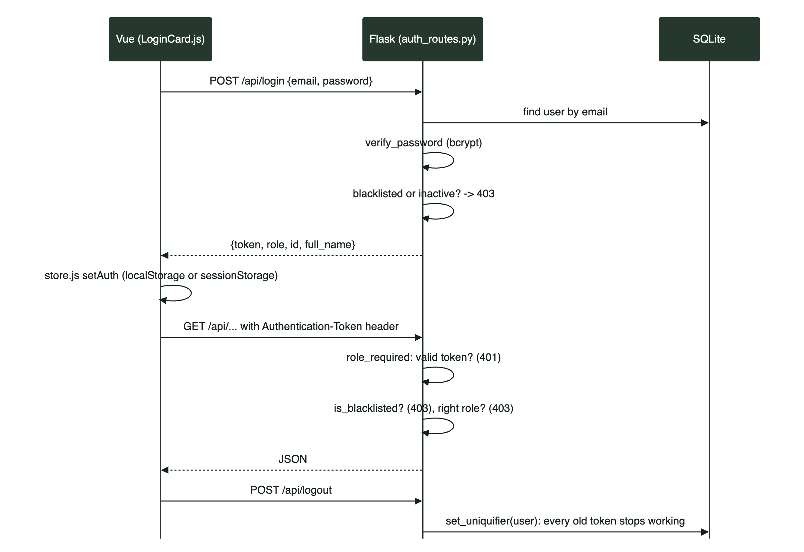

## Registration

`POST /api/register` with `email`, `password`, `full_name` and `contact_number`.

1. `validate_registration()` checks: a valid email (normalised to lower-case), a password of at least 6 characters, a name of at least 2 characters, and a phone number of 10–15 digits.
2. 409 if the email already exists.
3. `datastore.create_user(...)` with `password=hash_password(...)` and the role `user`. Flask-Security fills in a random `fs_uniquifier`.

The frontend (`Register.js`) checks the same rules first (plus an Indian mobile number starting with 6–9, matching passwords, and a password strength meter), but **the server is the real check**: anyone can send requests without our UI.

## Why register ignores the `role` field

Public sign-up only ever creates trekkers. If the code used `role` from the request body, anyone could send `{"role": "admin"}` and become an admin. This attack is called **mass assignment** or privilege escalation. The register route never reads `role`; staff are created only by the admin, and the one admin only by the seed script. (In the Phase 9 test, registering with `"role": "admin"` produced a normal trekker.)

## Login and tokens

`POST /api/login` with `{email, password}`:

1. Find the user. `verify_password(password, user.password)` hashes the attempt the same way and compares.
2. Wrong email or wrong password → the same 401 "Invalid email or password." Different messages would let an attacker find out which emails are registered.
3. Blacklisted → 403. Inactive → 403.
4. Return `{token, role, id, full_name}`. The token comes from `user.get_auth_token()`.

**What is the token?** A string signed with `SECRET_KEY` that contains the user's `fs_uniquifier`. On every request Flask-Security checks the signature (has it been tampered with?), the age (older than 24 hours is rejected) and that the `fs_uniquifier` inside still matches the database. The server doesn't need to store tokens.

**Where the browser keeps it:** `store.js` saves `{token, role, id, fullName}` in `localStorage` if "Remember me" is ticked (survives closing the browser) or `sessionStorage` if not (this tab only). `api.js` adds the header `Authentication-Token: <token>` to every request.

## Logout and `fs_uniquifier`

`POST /api/logout` calls `set_uniquifier(current_user)`, which gives the user a new random `fs_uniquifier`. Every token made before now contains the old value, so all of them fail, on **every device**. The same happens on a password change (`utils/profile.py`), except the current device is sent a fresh token. On the frontend, `logout()` in `api.js` calls the server and then clears local storage even if the call failed.

## Password hashing with bcrypt

`SECURITY_PASSWORD_HASH = "bcrypt"`. bcrypt:

- adds a random **salt** to every password, so two people with the same password get different hashes, and precomputed "rainbow tables" are useless;
- is deliberately **slow** (a cost factor), so guessing billions of passwords is impractical;
- stores the algorithm, cost and salt inside the hash string (`$2b$12$...`).

Flask-Security also mixes in `SECURITY_PASSWORD_SALT` (an HMAC) before bcrypt. The plain password is never stored or logged.

## Role-based access: `role_required`

```python
def role_required(*roles):
    def decorator(fn):
        protected = roles_accepted(*roles)(fn) if roles else fn

        @wraps(fn)
        def check_blacklist(*args, **kwargs):
            if current_user.is_blacklisted:
                return json_error("Your account has been blacklisted.", 403)
            return protected(*args, **kwargs)

        return auth_required("token")(check_blacklist)
    return decorator
```

Read it from the outside in. A request passes through three checks:

1. `auth_required("token")`: is there a valid token? If not, **401**.
2. `check_blacklist`: is this user blacklisted? If so, **403**.
3. `roles_accepted(*roles)`: does the user have one of the roles? If not, **403**.

`token_required` is `role_required()` with no roles: any logged-in, non-blacklisted user. `@wraps(fn)` keeps the original function name, which Flask needs because it uses function names as endpoint names.

**401 vs 403:** 401 means "I don't know who you are" (log in). 403 means "I know who you are, but you're not allowed".

## "Only the assigned staff member"

A role check isn't enough: staff1 is staff, but must not manage staff2's trek. `get_my_trek()` in `staff_routes.py` loads the trek and compares `trek.staff_id` with `current_user.id` (403 if different). The list endpoints filter `Trek.query.filter_by(staff_id=current_user.id)`, so other staff members' treks never appear. This is called **object-level authorisation**. The same idea protects trekkers: bookings, payments, certificates and exports all check `booking.user_id != current_user.id` and answer 404.

## Blacklisting

`PUT /api/admin/users/<id>/blacklist` sets `is_blacklisted = True` (the admin account can't be blacklisted: 403). It takes effect on the user's **next request**, because `role_required` checks the flag every time, even for a token issued before. Login refuses blacklisted users, and `AppLayout.js` calls `GET /api/me` when a page loads; a 403 there clears the session and returns to the login page. A blacklisted user also can't book (403), and is skipped (marked `Left`) if they were on a waitlist when a seat frees up. Whitelisting sets the flag back.

## Input validation, front and back

| Where | Purpose | Examples |
|---|---|---|
| Frontend | Fast, friendly feedback | `LoginCard.js` email format; `Register.js` strength meter and matching passwords; `TrekForm.js` end date not before start date; `Checkout.js` card number, MM/YY expiry and CVV |
| Backend | The real security boundary | `utils/validators.py` for every body and query parameter; `json_body()` treats a missing or non-object body as `{}`; `to_int()` rejects `true` and `2.5`; CHECK constraints in the database |

Other protections:

- SQLAlchemy uses **bound parameters**, so user input is never pasted into SQL (no SQL injection). Search uses `ilike(f"%{search}%")`, which is still a parameter.
- Vue escapes `{{ }}` output, and the email Jinja environment autoescapes HTML (no XSS).
- Error responses never include stack traces.
- CSV export filenames include a random part (`secrets.token_hex(4)`) and the owner's id, and are served only through the authorised endpoint.

## What would change for production

| Topic | Now | For production |
|---|---|---|
| HTTPS | Plain HTTP on localhost | TLS everywhere (for example nginx or a platform load balancer); tokens must never travel over plain HTTP |
| Server | `app.run(debug=True)` | A real WSGI server (gunicorn) behind nginx, with debug off |
| Rate limiting | None | Flask-Limiter on `/api/login` and `/api/register` to stop password guessing |
| CSRF | Off (`WTF_CSRF_ENABLED = False`) | Fine while the token is sent in a header, because browsers don't attach custom headers automatically. If we moved the token into a cookie, CSRF protection would be needed |
| Token storage | `localStorage` / `sessionStorage`, readable by JavaScript | An HttpOnly, Secure cookie so an XSS bug can't steal it; plus a Content-Security-Policy header |
| Token expiry | 24 hours, no refresh | Shorter tokens plus refresh tokens |
| Secrets | `.env` file | A secret manager; long random values |
| Staff passwords | The welcome email contains the chosen password | Send a one-time "set your password" link instead |
| Database | SQLite | PostgreSQL with backups |

# 8. Business logic deep dives

## Booking: the order of checks and why

```python
trek_id = to_int(json_body().get("trek_id"))          # 1. valid input        -> 400
trek = db.get_or_404(Trek, trek_id, ...)              # 2. trek exists        -> 404
if trek.status != "Open": abort(400, ...)             # 3. open for booking   -> 400
if current_user.is_blacklisted: abort(403, ...)       # 4. allowed to book    -> 403
already = Booking.query.filter_by(user_id=..., trek_id=..., status="Booked").first()
if already: abort(409, ...)                           # 5. no duplicate       -> 409
if not take_one_slot(trek.id):                        # 6. claim a seat       -> 409
    db.session.rollback(); abort(409, ...)
```

The order goes from **cheap and general** to **expensive and specific**:

- Bad input is rejected before touching the database.
- "Not found" is answered before "not open", because that's the more basic fact.
- The blacklist check is already done by `role_required`; it's repeated here so all the business rules are visible in one place.
- Only when everything else is fine do we **change** data (take a seat). If a check failed after taking the seat, we would have to put it back.
- The duplicate check comes before taking the seat, so a double-click doesn't waste a seat.

## Overbooking and the last-seat race condition

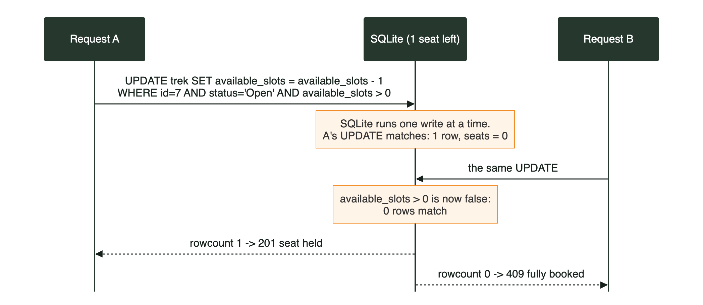

**The naive way (wrong):**

```python
trek = Trek.query.get(7)
if trek.available_slots > 0:          # A reads 1 ... B also reads 1
    trek.available_slots -= 1         # A writes 0 ... B writes 0
    db.session.commit()               # two bookings, one seat!
```

Between the read and the write, another request can read the same old value. This is a **race condition** (also called check-then-act).

**The TMA way (right):** do the check and the change in **one SQL statement**:

```python
def take_one_slot(trek_id):
    result = db.session.execute(
        update(Trek)
        .where(Trek.id == trek_id, Trek.status == "Open", Trek.available_slots > 0)
        .values(available_slots=Trek.available_slots - 1)
        .execution_options(synchronize_session=False)
    )
    return result.rowcount == 1
```

- The database runs a single statement **atomically**: nothing can happen between its `WHERE` check and its `SET`. SQLite also allows only one writer at a time.
- The first request matches the row (1 → 0) and gets `rowcount == 1`.
- The second request runs the same statement, but `available_slots > 0` is now false, so it matches **0 rows** and gets "fully booked".
- `synchronize_session=False` tells SQLAlchemy not to try to update Python objects already in memory; we refresh them when we need them.

In the Phase 9 end-to-end test, 8 people sent a booking request for the last seat at the same moment: exactly one got 201 and seven got 409.

The same pattern protects payments (`WHERE payment_status = 'Pending'`), cancelling (`WHERE status = 'Booked'`), and waitlist promotion (`_claim_entry`: `WHERE status = 'Waiting'`). The partial unique index `uq_one_active_booking` is a second safety net against duplicate bookings.

## Payment simulation, refunds, the 30-minute hold and auto-cancel

**Simulation.** No real money moves. `pay()` behaves like a gateway: about 1 second of "processing", a random transaction reference, and a decline for any card ending in `0000`. A declined attempt is still saved as `Payment(status="Failed")`, with a notification, and the API answers 402. The booking stays `Pending`, so the user can retry.

**The 30-minute hold.** A new booking takes a seat immediately, but its `payment_status` is `Pending`. `PAYMENT_WINDOW_MINUTES = 30` in `models.py`, and `Booking.payment_due_at` is `booking_date + 30 min`. The checkout page counts down to it, and My Bookings shows "N min left to pay".

**What releases an unpaid seat:**

1. Paying late: `pay()` sees the deadline has passed, cancels the booking itself and answers 400 "The payment window has expired and the seat was released."
2. The Celery beat job `auto_cancel_unpaid`, every 10 minutes: it finds `Booked` + `Pending` bookings older than 30 minutes and cancels each one with `only_if_unpaid=True`. A payment that lands at the same moment wins, because the cancel `UPDATE` then matches 0 rows.
3. The trek being completed (`complete_trek()` cancels unpaid holds).

**Cancelling and refunds** (`cancel_booking()` in `utils/bookings.py`):

```python
result = db.session.execute(
    update(Booking).where(Booking.id == booking.id, Booking.status == "Booked")
    .values(status="Cancelled", cancelled_at=now)
    .execution_options(synchronize_session=False)
)
if result.rowcount != 1:
    return False, []                     # already cancelled by someone else
...
if booking.payment_status == "Paid":
    booking.payment_status = "Refunded"
    db.session.add(Payment(..., status="Refunded"))
notify(...)
give_back_one_slot(trek.id)
promoted = promote_from_waitlist(trek.id)
```

One transaction does all of it: status, refund record, notification, seat back and waitlist promotion. Either everything is saved or nothing is.

## Waitlist: joining, positions, promotion

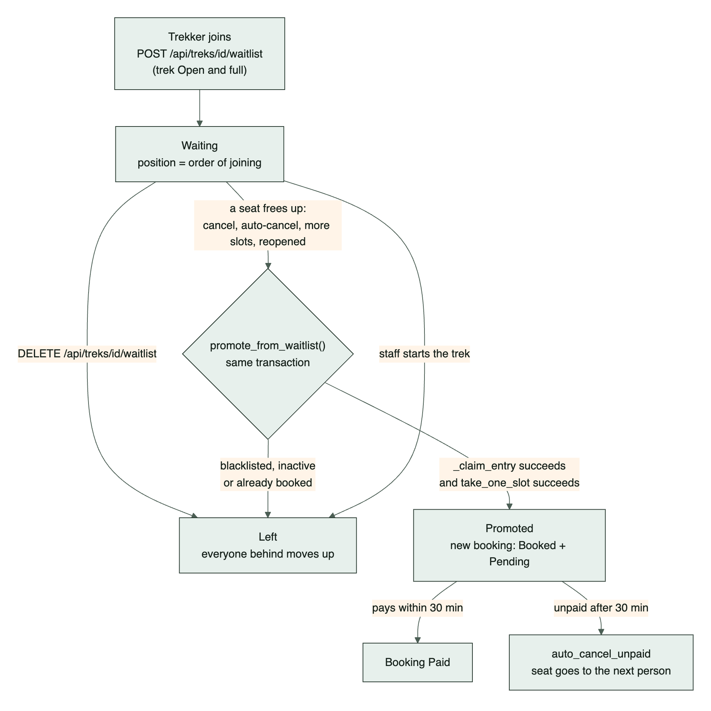

**Joining** is only possible when the trek is `Open` with 0 free seats, and you don't already have an active booking or a waiting entry.

**Positions** are computed, not typed in. `renumber_waitlist()` sorts the `Waiting` rows by `id` (which is the order people joined) and sets `position` to 1, 2, 3... It runs after every join, leave and promotion, so positions never have gaps.

**Promotion.** `promote_from_waitlist(trek_id)` is called wherever seats can appear: cancellation, auto-cancel, staff adding seats or reopening a trek, and the admin raising `total_slots`.

```python
db.session.flush()
trek = db.session.get(Trek, trek_id)
db.session.refresh(trek)                 # seats may have changed by UPDATE statements
if trek.status != "Open":
    return []
for entry in Waitlist.query.filter_by(trek_id=trek_id, status="Waiting").order_by(Waitlist.id):
    user = db.session.get(User, entry.user_id)
    if not user.active or user.is_blacklisted or has_booking:
        _claim_entry(entry.id, "Left")          # can't be promoted: skip them
        continue
    if not _claim_entry(entry.id, "Promoted"):  # someone else promoted them first
        continue
    if not take_one_slot(trek_id):              # no seat left after all: put them back
        _claim_entry_back(entry.id)
        break
    booking = Booking(..., status="Booked", payment_status="Pending", ...)
    notify(entry.user_id, "A spot opened up!", ...)
```

How it stays correct:

- **Same transaction:** the seat is freed and given to waitlist #1 before anything is committed, so no other trekker can grab it in between. (In the test, a direct booking attempt while someone was waiting got 409.)
- **`flush()` then `refresh(trek)`:** earlier statements changed `available_slots` in the database with `UPDATE`, so we re-read the real value.
- **Compare-and-set** (`_claim_entry`): an entry only moves from `Waiting` to `Promoted` if it is still `Waiting`, so two processes can't promote the same person twice.
- **Seats are taken through `take_one_slot()`**, so promotion obeys the same overbooking rule.
- The promoted person gets the normal 30-minute window. If they don't pay, auto-cancel releases the seat, and that triggers the next promotion.
- When staff start a trek, all waiting entries become `Left` ("Waitlist closed").

## Trek lifecycle

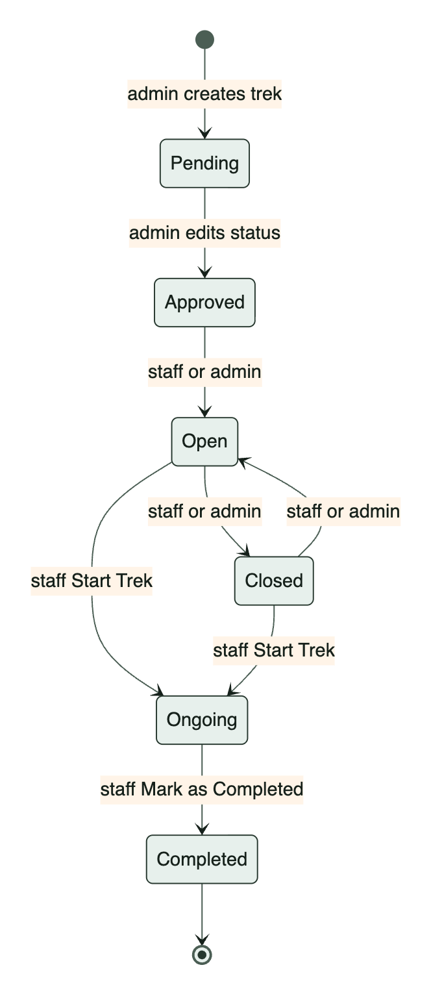

The admin can set any status through the trek form, but `validate_trek()` checks that the status agrees with the dates whenever the status or the dates change (`status_date_problem()`): a Completed trek can't end in the future, an Ongoing trek's dates must include today, and Open, Approved and Pending treks must start in the future. Staff can only switch between Open and Closed, start, and complete.

## Reviews

- Only for your own **Completed** booking, one per booking (unique `booking_id`).
- `Trek.rating_summary()` returns the average (rounded to 1 decimal) and the count, using **visible** reviews only.
- The admin can hide a review (the author is notified "Review hidden"), unhide it or delete it. Hidden reviews disappear from the trek page and its average.
- `GET /api/treks?sort=rating` sorts by that average.

## Notifications

- Stored in the `notification` table, created with `notify()` inside the same transaction as the event.
- Created for: seat held, payment success or failure, booking cancelled (including auto-cancel and unpaid at completion), waitlist joined, promoted or closed, trek status changed or started, trek completed, trek assigned to staff, review hidden.
- `NotificationBell.js` polls `GET /api/notifications/unread-count` every 30 seconds (not from background tabs), refreshes when the tab becomes visible again, and refreshes immediately after booking, payment and waitlist calls (the `tma:data-changed` event from `api.js`). The bell shakes when the count goes up.

## Packing checklist

- **Default items** are stored per difficulty (`checklist_item.difficulty`), seeded from the `CHECKLIST` list in `create_initial_data.py`. Each item says from which difficulty it is needed and from which it is essential: "Microspikes" is only on Hard treks, and "Woollen cap and gloves" is optional on Easy treks and essential from Moderate up.
- **Trek-specific items** are added by the admin (`POST /api/admin/treks/<id>/checklist`).
- `GET /api/treks/<id>/checklist` merges both, grouped by Documents, Clothing, Gear and Health, essentials first.
- The trekker's ticks are a personal to-do list, saved in the browser's `localStorage` (`tma.packing.<trek_id>`) by `PackingChecklist.js`, not on the server.

## Certificate generation

`GET /api/user/bookings/<id>/certificate`: your own **Completed** booking only. The certificate number `TMA-<year>-<booking id, 6 digits>` is issued on the first download and saved. `tasks/templates/certificate.html` (A4 landscape, built with tables for xhtml2pdf) is rendered with the trekker's name, trek, location, dates, difficulty, duration, trek leader and issue date, then converted by `html_to_pdf()` and sent as a download. The PDF is generated on request (it is quick), not in Celery.

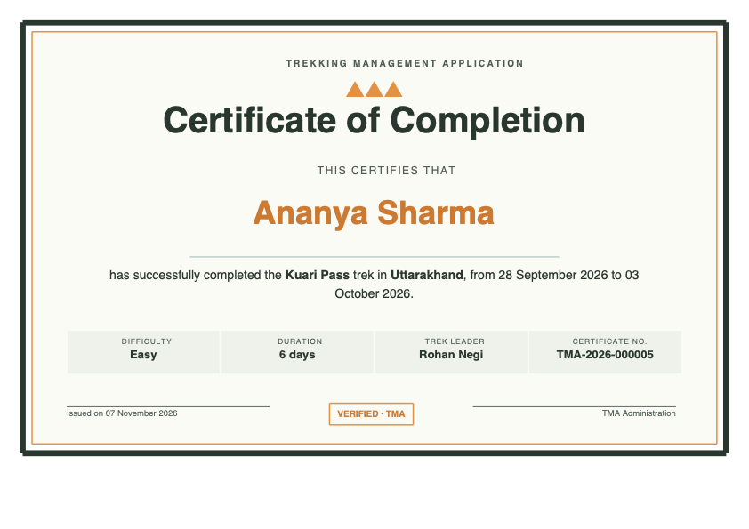

# 9. Caching with Redis

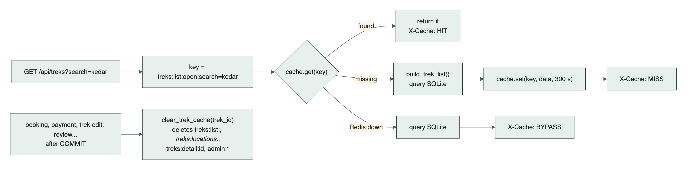

## What is cached

Only **shared** data, never anything that belongs to one user:

| Key (prefix `tma:`) | Endpoint | Expiry |
|---|---|---|
| `treks:list:<scope>:<sorted query string>` | `GET /api/treks` | 5 min (`CACHE_TTL_TREKS`) |
| `treks:detail:<id>` | `GET /api/treks/<id>` | 5 min |
| `treks:locations:<scope>` | `GET /api/treks/locations` | 30 min (`CACHE_TTL_LOCATIONS`) |
| `admin:stats` | `GET /api/admin/stats` | 2 min (`CACHE_TTL_ADMIN`) |
| `admin:reports:<from>:<to>` | `GET /api/admin/reports` | 2 min |

- `<scope>` is `open` for trekkers and `all` for admin and staff, so a trekker can never receive the admin's list (which includes Pending treks).
- `query_key()` sorts the query parameters, so `?page=2&search=x` and `?search=x&page=2` share one cache entry.
- The reports key includes both dates, so each date range is cached separately.

## How it works

```python
def get_or_compute(key, timeout, compute):
    try:
        data = cache.get(key)
    except Exception as error:      # Redis down, timeout...
        _warn("read", error)
        return compute(), "BYPASS"
    if data is not None:
        return data, "HIT"
    data = compute()
    try:
        cache.set(key, data, timeout=timeout)
    except Exception as error:
        _warn("write", error)
        return data, "BYPASS"
    return data, "MISS"
```

`compute` is a function that does the real database work (for example `build_trek_list`), so it only runs on a MISS. We cache plain dicts, never Flask `Response` objects.

## Invalidation: why and how

A cache entry is a **copy**. When the real data changes (a booking takes a seat), the copy is wrong until it's deleted. Waiting up to 5 minutes for it to expire would show wrong seat counts, so every write deletes the affected keys **after** `db.session.commit()`:

- `clear_trek_cache(trek_id)` deletes `treks:list:*` (any filtered page might contain this trek), `treks:locations:*`, `treks:detail:<id>` and `admin:*`.
- `clear_admin_cache()` deletes `admin:*` (used after registration, staff creation, payment, profile name changes and waitlist changes).

`_delete_matching()` uses Redis `SCAN` (not `KEYS`, which blocks Redis on big databases) to find keys by pattern, then deletes them.

Why after the commit? If we cleared the cache before committing, another request could re-fill it with the **old** data in between.

The expiry time is still useful as a safety net: if an invalidation is ever missed, the data corrects itself within minutes.

## The `X-Cache` header

`json_with_cache_header()` adds `X-Cache: HIT`, `MISS` or `BYPASS` to cached endpoints. In a demo, open the browser's Network tab: the first load of Browse Treks shows `MISS`, a refresh shows `HIT`, and after booking a seat it shows `MISS` again.

## What if Redis is down?

The app keeps working, just slower:

- Cache reads and writes fail fast (0.5 s socket timeouts) and are answered straight from SQLite with `X-Cache: BYPASS`. `_warn()` logs a warning at most once a minute instead of on every request.
- Invalidation failures are ignored, which is safe, because nothing is being served from Redis either.
- Background jobs can't be queued: `enqueue()` answers 503 (CSV export, manual job triggers), while `enqueue_quietly()` skips the email and lets the booking or payment succeed.

# 10. Background jobs with Celery

## The vocabulary

| Term | Meaning | In TMA |
|---|---|---|
| **Task** | A Python function Celery can run elsewhere | Functions decorated with `@celery.task` in `tasks/tasks.py` |
| **Broker** | The queue where "please run this task" messages wait | Redis db 1 (`CELERY_BROKER_URL`) |
| **Worker** | A separate process that takes messages from the queue and runs them | `celery -A tasks.celery_app worker` |
| **Beat** | A scheduler that puts tasks on the queue at set times | `celery -A tasks.celery_app beat` |
| **Result backend** | Where a finished task's status and return value are stored | Redis db 2 (`CELERY_RESULT_BACKEND`), kept 1 day |

Flask never runs a slow job itself. It calls `task.delay(args)`, which only writes a small message to Redis and returns a task id immediately.

## The schedule (`beat_schedule` in `tasks/celery_app.py`, timezone Asia/Kolkata)

| Entry | Task | When |
|---|---|---|
| `daily-reminder` | `tasks.daily_reminder` | Every day at 18:00 |
| `auto-cancel-unpaid` | `tasks.auto_cancel_unpaid` | Every 10 minutes |
| `monthly-report` | `tasks.monthly_report` | 1st of every month at 09:00 |

## Every job

**`daily_reminder()`.** Finds active (`Booked`) bookings on treks starting in 1–3 days (`REMINDER_DAYS_AHEAD`) for users who are active and not blacklisted. It emails each one `reminder_email.html`: the trek details, the trek leader's instructions and a "what to carry" list (with extra items for Hard treks). One failed address doesn't stop the others (each send is in its own try/except). If `GCHAT_WEBHOOK_URL` is set, it also posts a summary to Google Chat. The admin can trigger it with `POST /api/admin/jobs/daily-reminder`.

**`monthly_report(month=None)`.** Builds last month's report with `build_monthly_report()`: treks conducted (Completed treks that ended that month) with participants, total bookings, cancellations, unique trekkers, the top 5 treks, and bookings per staff member. `render("monthly_report.html")` gives the HTML, `html_to_pdf()` gives the PDF, and the HTML is emailed to every admin with the PDF attached. The same builder (`build_report(start, end)`) powers `GET /api/admin/reports/pdf` for any date range. Manual trigger: `POST /api/admin/jobs/monthly-report` with optional `{month: "YYYY-MM"}`.

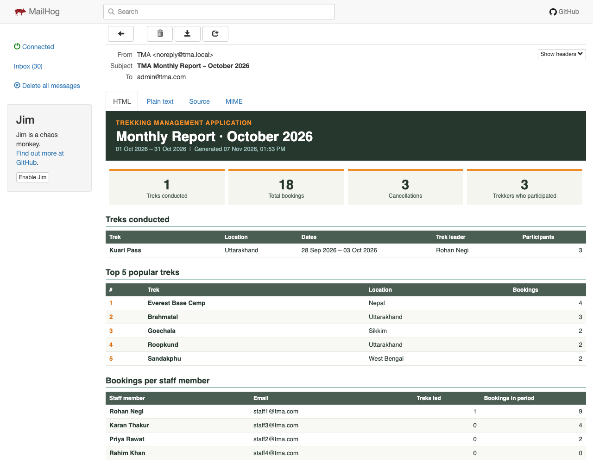

**`export_bookings_csv(user_id)`.** Writes all of the user's bookings to `static/exports/bookings_u<id>_<timestamp>_<random>.csv` with the columns User ID, Trek Name, Location, Booking Status, Booking Date, Trek Start Date and Trek End Date. It emails the file as an attachment and returns `{user_id, filename, rows}`.

**`auto_cancel_unpaid()`.** Described in section 8. Each booking is cancelled in its **own** transaction, so one failure doesn't undo the others, and it queues "cancelled" and "promoted" emails.

**`send_booking_email(booking_id, kind, reason="")`.** `kind` is `confirmed`, `cancelled` or `promoted`. It renders `booking_email.html` with the booking details, the payment reference (when confirmed), the refund line (when cancelled after paying) and the "pay within 30 minutes" box (when promoted).

**`send_staff_welcome(user_id, password)`.** Emails a new staff member their login details.

Every task returns a dict with `user_id`. `task_status()` uses it to make sure a user can only see their own results (`None` means an admin-only job).

## Why the CSV export is asynchronous

Exporting means querying every booking, writing a file and sending an email. That could take seconds, and for a user with thousands of bookings much longer. If Flask did this inside the request, the browser would wait, the request could time out, and one web worker would be blocked for everyone. As a Celery task, the request returns `202 Accepted` with a task id in milliseconds, and the work happens in the worker.

## How the frontend polls

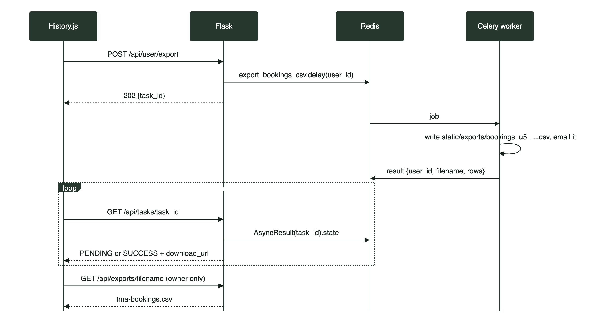

`History.js`:

```js
const { task_id: taskId } = await post('/user/export');
this.poll(taskId);
...
async poll(taskId) {
  const job = await get(`/tasks/${taskId}`);
  if (job.status === 'SUCCESS') { /* toast with a Download button */ return; }
  if (job.status === 'FAILURE') throw new Error(job.message);
  if (Date.now() - this.pollStarted > GIVE_UP_AFTER_MS) throw new Error('The export is taking too long...');
  this.pollTimer = setTimeout(() => this.poll(taskId), POLL_EVERY_MS);
}
```

- `POLL_EVERY_MS = 2000`: ask every 2 seconds. `GIVE_UP_AFTER_MS = 60000`: stop after a minute.
- `setTimeout` (not `setInterval`) means a new check only starts after the previous one finished.
- On success the toast's **Download** button calls `download('/exports/<file>')`. That fetches the file with the token header (a plain `<a href>` can't send headers), turns it into a blob and saves it through a temporary link.
- `beforeUnmount()` clears the timer, so leaving the page stops the polling.

**Alternatives to polling:** WebSockets or Server-Sent Events, where the server pushes "done". Polling is simpler and good enough for a job that takes a few seconds.


# 11. Frontend, file by file

## How `index.html` loads Vue without a build step

`templates/index.html` is the only HTML page. In order, it:

1. Adds the PWA manifest, theme colour, app icons and an inline SVG favicon.
2. **Preloads** the login video and its last frame, so the intro starts quickly.
3. Loads the Google Fonts Fredoka (headings) and Inter (body), Bootstrap 5.3.3 and Bootstrap Icons 1.11.3 from jsDelivr, then our CSS: `theme.css` (tokens first), `auth.css` and `style.css`.
4. Declares an **import map**:

```html
<script type="importmap">
{ "imports": {
    "vue": "https://unpkg.com/vue@3.5.13/dist/vue.esm-browser.prod.js",
    "vue-router": "https://unpkg.com/vue-router@4.5.0/dist/vue-router.esm-browser.prod.js" } }
</script>
```

An import map tells the browser what a bare name like `'vue'` means, so our files can write `import { createApp } from 'vue'` exactly as they would with a bundler.

5. `<div id="app"></div>` is where Vue renders. `<script type="module" src="/static/js/app.js">` starts the app.
6. A small script registers the service worker after the page loads, then sends it the list of files this first visit downloaded (`performance.getEntriesByType('resource')`), so even the first visit is cached.

**Why the "esm-browser" build?** Our components use `template:` strings, which must be compiled in the browser. That build includes Vue's template compiler.

## `app.js`

```js
const App = { components: { ToastHost, ConfirmHost },
              template: `<router-view /> <ToastHost /> <ConfirmHost />` };
const app = createApp(App);
app.config.globalProperties.$toast = toast;
app.use(router);
app.mount('#app');
```

The root component shows the current route plus two global hosts: toasts and the confirm dialog. `$toast` makes `this.$toast.success(...)` available in every component.

## `router.js` and the guard

- `createWebHashHistory()`: URLs look like `/#/admin/treks`. The part after `#` never reaches the server, so Flask only needs the `/` route, and refreshing any page works.
- Each role has **one parent route** that renders `AppLayout` (sidebar, top bar, footer) with `meta: { role: 'admin' }`, and its pages are `children`. For example `page('treks', 'Manage Treks', ManageTreks)`. The helper `page()` sets `meta.title`, which becomes the browser tab title and the top bar title.
- The last route `/:pathMatch(.*)*` catches unknown URLs and shows `NotFound`.

```js
router.beforeEach((to) => {
  if (to.meta.guestOnly && isLoggedIn()) return dashboardPath();
  const requiredRole = to.matched.find((record) => record.meta.role)?.meta.role;
  if (requiredRole) {
    if (!isLoggedIn()) return { path: '/login', query: { redirect: to.fullPath } };
    if (auth.role !== requiredRole) return dashboardPath();
  }
  return true;
});
```

- Logged-in users can't see Login or Register (`guestOnly`).
- `to.matched` includes the parent route, so children inherit the role.
- Not logged in → Login, remembering where they wanted to go (`redirect`). After login, `Login.js` only follows a redirect that starts with `/` (and not `//`), so it can't be used to send someone to another website (an open redirect).
- Wrong role → their own dashboard.

**Important:** the guard is for user experience only. The real protection is on the server (`role_required`). Anyone can edit JavaScript in their own browser.

## `api.js`

- `api(path, { method, body, withAuth })` calls `fetch('/api' + path)`, adds `Accept`, `Content-Type` and the `Authentication-Token` header.
- A network failure becomes `ApiError('Cannot reach the server...', 0)`.
- An error response becomes `ApiError(message, status, errors)`, using the server's `{"message": ...}` and the field errors from 400 responses, which the forms show under each field.
- **401 handling:** if a request with the **current** token gets 401 (expired, or logged out on another device), it calls `clearAuth()` and goes to `#/login`. The "current token" check matters: a slow reply to an old token (for example a bell poll that overlaps a password change) must not log the user out.
- After any non-GET call to bookings, payments or a waitlist, it fires `window` event `tma:data-changed`, so the bell refreshes right away (also on failures, because a declined payment creates a notification too).
- `logout()`, `download(path)` (fetch → blob → temporary `<a download>` link; the file name comes from `Content-Disposition`), and the shortcuts `get`, `post`, `put` and `del`.

## `store.js`

`auth` is a `reactive()` object `{token, role, id, fullName}`. Any component that reads it re-renders when it changes (for example the name in the top bar). It's restored from `localStorage` ("Remember me") or `sessionStorage` when the page loads. `setAuth()`, `clearAuth()`, `isLoggedIn()`, `dashboardPath(role)` and `ROLE_LABELS` ("Admin", "Trekking Staff", "User (Trekker)"). `prefs` holds per-browser preferences (`sidebarCollapsed`, `perPage`) saved by `setPref()`. Every storage access is wrapped in `try/catch`, because private browsing can block storage.

## `utils/`

- `booking.js` → `startBooking(trek, router)`: confirm dialog, `POST /bookings`, toast, go to Checkout.
- `waitlist.js` → `myTreks` (a reactive map of the trekker's booked and waiting treks, so every trek card can show "Waitlist #2" without its own API call), `refreshMyTreks()`, `joinWaitlist()`, `leaveWaitlist()`.
- `format.js` → `formatDate()` (plain `YYYY-MM-DD` dates are read as local dates, not UTC midnight), `timeAgo()`, `formatRange()`, `formatMoney()` (₹ with Indian grouping: ₹1,15,000) and `badgeClass()`.
- `constants.js` → difficulties, statuses and the duration filter options.
- `motion.js` → `prefersReducedMotion()`, `canHover()`, `typewriter()`, `addRipple()` and `confettiBurst()`.

## Components (`static/js/components/`)

| Component | What it shows | API calls |
|---|---|---|
| `AppLayout.js` | Shell for logged-in pages: Sidebar, Navbar, page area with a fade transition, footer | `GET /api/me` on load (403 → logged out) |
| `Sidebar.js` | Role menu (`MENUS`), Logout pinned at the bottom; drawer on phones, collapsible icon rail on desktop | none |
| `Navbar.js` | Menu button, page title, bell, user dropdown (Profile, Install app, Logout) | none |
| `NotificationBell.js` | Bell, unread badge, dropdown list | `GET /notifications/unread-count`, `GET /notifications?per_page=8`, `PUT .../<id>/read`, `PUT .../read-all` |
| `InstallPrompt.js` | "Install app" menu item, only when the browser allows install | none |
| `Toast.js` | Global toasts (`toast.success/error/info`), optional action button | none |
| `ConfirmDialog.js` | Promise-based "Are you sure?" (`await confirmDialog({...})`) | none |
| `EmptyState.js` | Friendly empty message with an SVG tent and campfire | none |
| `Loader.js` | Themed loader: a hiker climbs a trail (CSS `offset-path`) | none |
| `Pagination.js` | ‹ 1 2 3 › pager, at most 5 numbers | none |
| `StatCard.js` | Dashboard number tile that counts up | none |
| `TrekCard.js` | Trek card: image, difficulty, days, price, slots left (red at ≤ 3), Book / View Details, Join Waitlist / Waitlist #N | via `utils/waitlist.js` |
| `TrekImage.js` | Trek photo, or a generated SVG mountain scene, the same for each trek id | none |
| `PackingChecklist.js` | Grouped checklist with ticks saved in `localStorage` | `GET /treks/<id>/checklist` |
| `StarRating.js` | Stars for display (fractional) or input (click, arrows, keys 1–5) | none |
| `PaymentModal.js` | Processing / success / failed dialog on Checkout | none |
| `PeopleList.js` | Searchable staff or trekker table with Blacklist / Whitelist | `GET /admin/staff` or `/admin/users`, `PUT /admin/users/<id>/blacklist|whitelist` |
| `StaffTrekTable.js` | "My Assigned Treks" table for staff | none |
| `ChartCard.js` | One Chart.js chart with a Table toggle and an empty state | none (data comes from Reports) |
| `AccountForms.js` | Edit account and change password (Admin Settings, Staff Profile) | `GET/PUT /profile` |
| `AuthBackground.js` | Login/register background: video, poster, clouds, parallax | none |
| `ParticleLayer.js` | Floating lights on a canvas | none |
| `TiltCard.js` | 3D tilt wrapper for the login card | none |
| `LoginCard.js` | The glass login form | via the `login` prop (`POST /login`) |
| `RoleSelector.js` | Admin / Trekking Staff / User tiles (a hint only; the server decides the role) | none |
| `TrekkerFooter.js` | Footer with animated hikers | none |

## Pages (`static/js/pages/`)

| Page | What it shows | API calls |
|---|---|---|
| `Login.js` | Video intro, then the login card | `POST /login` |
| `Register.js` | Trekker sign-up with live checks; then go to Login with the email filled in | `POST /register` |
| `NotFound.js` | 404 with an SVG signpost | none |
| `admin/AdminDashboard.js` | 4 stat cards + recent bookings | `GET /admin/stats` |
| `admin/ManageTreks.js` | Trek table, search, status filter, edit, checklist editor, delete | `GET /admin/treks`, `DELETE /admin/treks/<id>`, checklist endpoints |
| `admin/TrekForm.js` | Create / edit trek modal, including assigning staff | `POST /admin/treks`, `PUT /admin/treks/<id>`, `PUT .../assign`, `GET /admin/staff` |
| `admin/ManageStaff.js`, `ManageUsers.js` | `PeopleList` for staff / trekkers | see PeopleList |
| `admin/CreateStaff.js` | New staff form (status Active or Blacklisted) | `POST /admin/staff` (+ blacklist) |
| `admin/AllBookings.js` | Every booking, filter by status and trek | `GET /admin/bookings`, `GET /admin/treks` |
| `admin/AdminSearch.js` | One box, tabs Users / Staff / Treks | `GET /admin/search?q=&type=` |
| `admin/Reports.js` | Date range, presets, 6 charts, PDF download | `GET /admin/reports?from=&to=`, `GET /admin/reports/pdf` |
| `admin/ManageReviews.js` | Reviews with Hide / Unhide / Delete | `GET /admin/reviews`, `PUT .../hide|unhide`, `DELETE` |
| `admin/Settings.js` | Account forms + rows per page + compact sidebar | `/profile` |
| `staff/StaffDashboard.js` | 3 stat cards + assigned treks | `GET /staff/dashboard`, `GET /staff/treks?per_page=5` |
| `staff/MyTreks.js` | All assigned treks, search, status filter | `GET /staff/treks` |
| `staff/ManageTrek.js` | Details, slots and status form, Start / Mark as Completed, participants, waitlist | `GET /staff/treks/<id>`, `GET .../waitlist`, `PUT /staff/treks/<id>`, `PUT .../start`, `PUT .../complete` |
| `staff/Participants.js` | Everyone booked on my treks, filter by trek, search | `GET /staff/treks`, then `GET /staff/treks/<id>` per trek |
| `staff/StaffProfile.js` | `AccountForms` with staff fields | `/profile` |
| `user/UserDashboard.js` | "Welcome, <name>", 6 treks with filters, upcoming bookings | `GET /treks?per_page=6`, `GET /treks/locations`, `GET /user/bookings?status=Booked&per_page=5` |
| `user/BrowseTreks.js` | Search + 4 filters, 3×3 grid, filters kept in the URL | `GET /treks?...`, `GET /treks/locations` |
| `user/TrekDetails.js` | Hero, about, instructions, checklist, reviews, booking panel | `GET /treks/<id>`, `GET /user/bookings`, `GET /user/waitlist`, `GET /treks/<id>/reviews` |
| `user/Checkout.js` | Payment methods, countdown, summary, result modal | `GET /user/bookings/<id>`, `POST /payments` |
| `user/MyBookings.js` | Tabs Upcoming / Cancelled / Waitlist; pay, cancel, leave | `GET /user/bookings?status=`, `GET /user/waitlist`, `PUT /bookings/<id>/cancel`, `DELETE /treks/<id>/waitlist` |
| `user/History.js` | Completed and cancelled; review, certificate, CSV export | `GET /user/history`, `POST /reviews`, certificate download, `POST /user/export`, `GET /tasks/<id>` |
| `user/Profile.js` | Edit details and password | `GET/PUT /user/profile` |

Some useful patterns used across pages:

- **Debounced search** (`setTimeout` 350 ms in a watcher): the API is called when typing pauses, not on every key.
- **Re-fetch after every change**, so the screen always shows what the server really has.
- **Filters in the URL** (`BrowseTreks.js`, `AdminSearch.js`): refresh and the back button keep them.
- `prefs.perPage` from Admin Settings controls table page sizes.

## The animations, in simple words

Everything checks `prefersReducedMotion()` (or the CSS media query `prefers-reduced-motion`) and is switched off for people who ask their system for less motion.

**Video intro → card.** `Login.js` renders `AuthBackground` with `mode="video"`. It plays `login-bg.mp4` once (muted, so browsers allow autoplay). When the video ends, or the user clicks "Skip intro", or autoplay is blocked, or nothing has played after 3 seconds, `finish()` runs: the video pauses and an image of its **exact last frame** (`login-bg-end.jpg`) fades in on top, so the switch is invisible. A slow "settle" zoom and a vignette start, and the component emits `done`. `Login.js` then sets `ready = true`, which renders the card inside `.card-enter`: the CSS `cardRise` animation slides it in from the side while `cardFocus` fades it from blurred to sharp. The title types itself (`typewriter()`), and the form fields fade in one after another (`--i` delays).

**3D tilt.** `TiltCard.js` listens to `pointermove`, works out where the cursor is inside the card as 0–1, and turns that into `rotateY` (left/right) and `rotateX` (up/down) of at most 8 degrees, with `perspective(900px)` so the near edge looks bigger. A glare (a radial gradient) follows the cursor through the CSS variables `--gx` and `--gy`. Updates are limited to once per frame with `requestAnimationFrame`. On leave it springs back with a CSS transition. It's off on touch screens.

**Particle canvas.** `ParticleLayer.js` draws one soft glowing dot once onto an off-screen canvas (a "sprite"). Every frame, each of the 60 particles moves up a little, sways sideways on a sine wave and twinkles, and the sprite is stamped at its position. Particles leaving the top start again at the bottom. Movement is multiplied by the real time between frames (`dt`), so the speed is the same on 60 Hz and 120 Hz screens. The loop stops when the tab is hidden.

**Background parallax.** `AuthBackground.js` moves the background slightly opposite to the mouse, easing 6% of the way to the target every frame, which gives a smooth, lagging motion.

**Trekker footer.** `TrekkerFooter.js` builds four tiny hikers as SVG. A 32-second CSS animation tells a story: three walk together, the fourth falls behind, wipes its forehead (a sweat drop falls), sits on a rock, the group stops and one hiker waves, and the straggler jogs to catch up. Every part uses the same duration (`--trek-cycle`), so the keyframe percentages act as one shared timeline. Positions are percentages of the footer width, so it works on any screen size.

**Confetti.** On a successful login, `confettiBurst()` in `motion.js` creates a temporary canvas, launches 90 small rectangles upwards from the Login button with random speed, spin and colour, applies gravity and air drag each frame, fades them out over about 1.1 seconds, removes the canvas, and **resolves a Promise**, so `LoginCard.js` can `await` it before redirecting.

**Smaller touches.** The button ripple (`addRipple`), the shake on a wrong password (`anim-shake`), count-up numbers (`StatCard.js`), the bell shake on new notifications, the role selector's sliding highlight, and page fade transitions (`<transition name="page">` in `AppLayout.js`).

## Reports with Chart.js and date ranges

`Reports.js` holds `from` and `to` (default: the last 6 months). Presets (This month, Last 3 months, Last 6 months, This year), the From/To date inputs and the month picker all set the same two values. Typed dates are debounced by 350 ms, and a `requestId` counter throws away a slow, out-of-date response, so the charts always match the dates on screen.

`GET /api/admin/reports?from=YYYY-MM-DD&to=YYYY-MM-DD` → `parse_report_range()` checks the format, the years 2000–2100, and that from ≤ to (400 otherwise), then `build_reports()` returns six `{labels, data}` series, each filtered by the range:

| Chart | Data |
|---|---|
| Top 5 popular treks | Bookings per trek (cancelled not counted), booked in the range |
| Bookings per month | One point per calendar month inside the range |
| Treks by status | Completed treks by `end_date`; others by `created_at` |
| Bookings by difficulty | Different trekkers per difficulty |
| Average rating per trek | Visible reviews written in the range |
| Waitlist demand | People still waiting who joined in the range |

`ChartCard.js` loads Chart.js once, then **updates the existing chart in place** (`chart.data = ...; chart.update()`). A `renderId` makes sure that if two updates overlap, only the newest draws, so one canvas never holds two charts. Each card has a Table toggle (the same numbers for screen readers) and shows "No data for these dates." when everything is 0. "Download PDF report" calls `GET /api/admin/reports/pdf?from=&to=` with the same range.

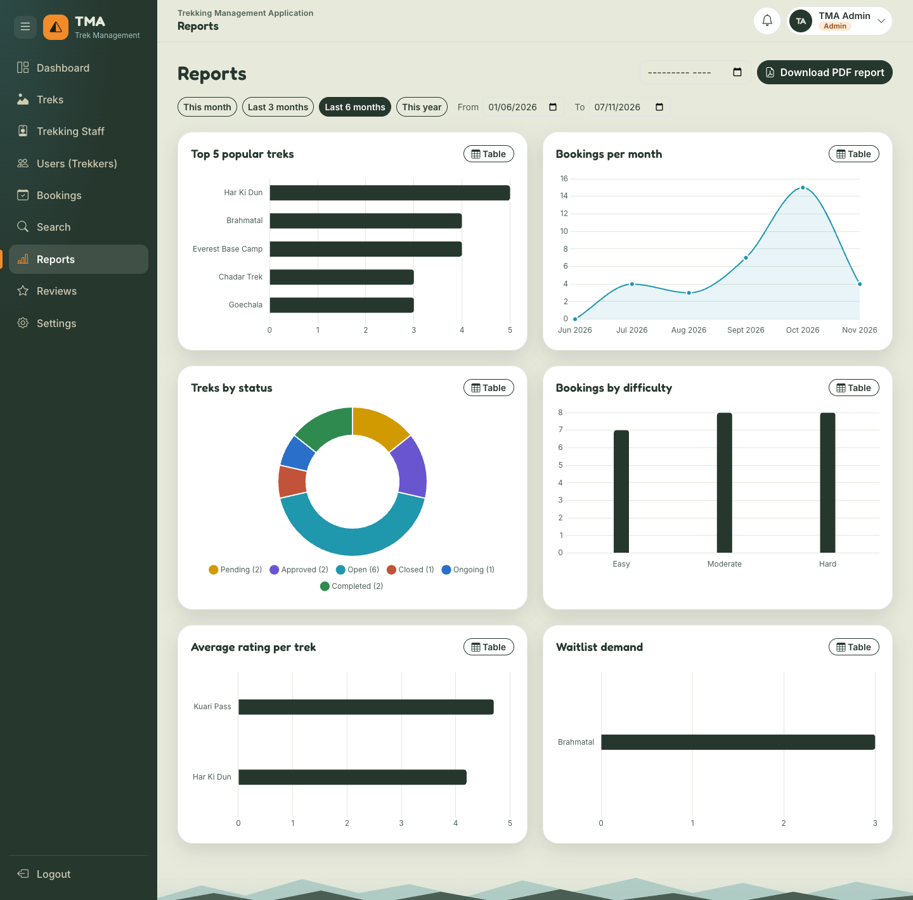

## Responsive design

- **Bootstrap's grid** (`row`, `col-lg-6`) stacks columns on small screens.
- **The sidebar** is fixed on desktop (≥ 992 px), an off-canvas drawer with a dark backdrop on phones and tablets (it closes on link click, Escape or a tap outside), and can be collapsed to an icon rail on desktop (saved in `prefs`).
- **Tables become cards on phones:** tables with the class `table-stack` hide their header, and each cell shows its column name from a `data-label` attribute.
- The trek grid is 1, 2 or 3 columns (`trek-grid` with media queries at 640 px and 1100 px). Filter bars wrap.
- `overflow-x: clip` on `html, body` is a safety net against sideways scrolling. The Phase 9 test checked 25 pages at 375 px, tablet and desktop width: no horizontal scroll and no console errors.

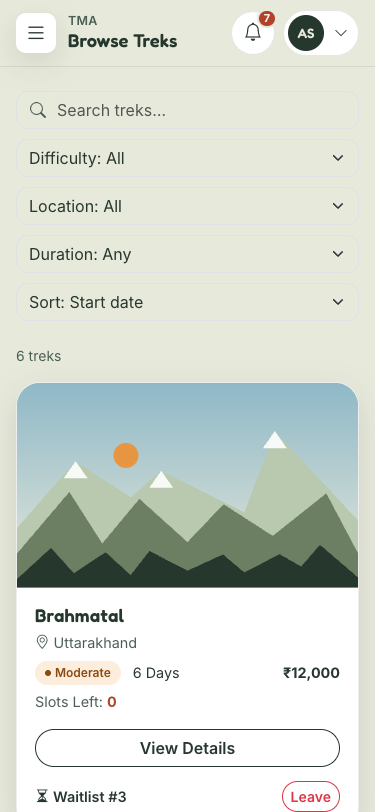

## The PWA

- **`manifest.json`:** name, short name "TMA", `display: "standalone"` (opens without browser bars), theme and background colours, and icons 192 px, 512 px and a "maskable" 512 px (safe area for round icons on Android).
- **`service-worker.js`** caches the "app shell" (CSS, JS, images, CDN libraries) under `tma-shell-v1`:
  - `/api/`, the login video and exports are **never** cached: data must always be fresh and private.
  - Page navigations: network first, falling back to the cached `/` when offline.
  - CDN files (their URLs contain the version): cache first.
  - Our own files: stale-while-revalidate (answer from the cache instantly, refresh it in the background). On localhost they're network-first, so code changes show up on a normal refresh.
  - `install` caches the shell list, `activate` deletes old `tma-shell-*` caches. Bumping `CACHE_VERSION` forces every installed copy to refresh.
- **`pwa_routes.py`** serves the worker at `/service-worker.js` so its scope is the whole site.
- **`InstallPrompt.js`** listens for the browser's `beforeinstallprompt` event as soon as the module loads, calls `event.preventDefault()` to hide the browser's own banner, and shows "Install app" in the user menu. Clicking it calls `event.prompt()`.


# 12. Complete API reference

All endpoints are under `/api`, send and receive JSON, and (except register and login) need the header `Authentication-Token: <token>`.

**Every protected endpoint can also answer:** 401 (no or invalid token), 403 (blacklisted, or the wrong role). These are not repeated in the tables.

**Shapes used below:**

- *Paginated:* `?page=1&per_page=10` (max 100) → `{items, page, per_page, total, pages}`
- *Validation error:* 400 `{"message": "Validation failed.", "errors": {"field": "problem"}}`
- *Other errors:* `{"message": "..."}`
- Choice values are case-insensitive (`open` = `Open`). Dates are `YYYY-MM-DD`.

## Auth (`routes/auth_routes.py`)

| Method & URL | Role | Purpose | Request | Success | Errors |
|---|---|---|---|---|---|
| POST `/register` | public | Create a trekker account | `email, password, full_name, contact_number` | 201 `{message, user}` | 400 validation, 409 email exists |
| POST `/login` | public | Log in | `email, password` | 200 `{token, role, id, full_name}` | 400 missing, 401 wrong, 403 blacklisted/inactive |
| POST `/logout` | any | Invalidate all my tokens | none | 200 `{message}` | |
| GET `/me` | any | Who am I | none | 200 user | |
| GET `/profile` | any | My account | none | 200 user | |
| PUT `/profile` | any | Edit my account | `full_name`, `contact_number`, (staff) `experience_years`, `specialization`, or `current_password` + `new_password` | 200 `{message, user}` (+ `token` after a password change) | 400 validation / wrong current password |

## Admin (`routes/admin_routes.py`, `routes/review_routes.py`)

| Method & URL | Purpose | Request | Success | Errors |
|---|---|---|---|---|
| GET `/admin/stats` | Totals + 5 recent bookings (cached 2 min) | none | 200 `{total_treks, total_users, total_staff, total_bookings, recent_bookings}` | |
| GET `/admin/treks` | All treks | `?search=&status=&page=&per_page=` | 200 paginated treks | 400 bad status |
| POST `/admin/treks` | Create a trek | `name, location, difficulty, duration_days, total_slots, price, start_date, end_date` + optional `description, instructions, image_url, status` | 201 `{message, trek}` | 400 validation (incl. status vs dates) |
| PUT `/admin/treks/<id>` | Edit any fields; extra seats go to the waitlist | any trek fields | 200 `{message, trek, promoted_from_waitlist}` | 400, 404, 409 total below booked |
| DELETE `/admin/treks/<id>` | Delete a trek | none | 200 `{message}` | 404, 409 has bookings |
| PUT `/admin/treks/<id>/assign` | Assign or unassign the leader | `{staff_id}` or `{staff_id: null}` | 200 `{message, trek}` | 400 not staff / blacklisted, 404 |
| POST `/admin/staff` | Create a staff member (emails login) | `full_name, email, password, contact_number, experience_years, specialization` | 201 `{message, staff}` | 400, 409 email exists |
| GET `/admin/staff` | Staff list + `assigned_treks_count` | `?search=&page=` | 200 paginated | |
| GET `/admin/users` | Trekker list + `bookings_count` | `?search=&page=` | 200 paginated | |
| PUT `/admin/users/<id>/blacklist` | Blacklist a trekker or staff member | none | 200 `{message, user}` | 403 admin account, 404 |
| PUT `/admin/users/<id>/whitelist` | Remove the blacklist | none | 200 `{message, user}` | 403, 404 |
| GET `/admin/bookings` | Every booking, history included | `?status=&trek_id=&page=` | 200 paginated | 400 |
| GET `/admin/search` | Search users, staff, treks (max 20 each) | `?q=&type=users|staff|treks` | 200 `{query, type, results}` | 400 no `q` |
| GET `/admin/reports` | Six charts for a range (cached per range) | `?from=&to=` (default last 6 months) | 200 `{from, to, bookings_per_trek, bookings_per_month, treks_by_status, users_by_difficulty, avg_rating_per_trek, waitlist_demand}` | 400 bad date / from after to |
| GET `/admin/reports/pdf` | Report PDF for the same range, or a month | `?from=&to=` or `?month=YYYY-MM` | 200 PDF file | 400, 500 PDF error |
| POST `/admin/jobs/daily-reminder` | Run the reminder job now | none | 202 `{task_id, message}` | 503 Redis down |
| POST `/admin/jobs/monthly-report` | Email a monthly report now | `{month?}` | 202 `{task_id, message}` | 400 bad month, 503 |
| POST `/admin/treks/<id>/checklist` | Add a trek-specific packing item | `{item, category, is_essential}` | 201 `{message, item}` | 400, 404 |
| DELETE `/admin/checklist/<item_id>` | Remove a trek-specific item | none | 200 `{message}` | 400 default item, 404 |
| GET `/admin/reviews` | All reviews for moderation | `?hidden=true|false&trek_id=&page=` | 200 paginated | 400 |
| PUT `/admin/reviews/<id>/hide` | Hide (author notified) | none | 200 `{message, review}` | 404 |
| PUT `/admin/reviews/<id>/unhide` | Show again | none | 200 `{message, review}` | 404 |
| DELETE `/admin/reviews/<id>` | Delete | none | 200 `{message}` | 404 |

All admin endpoints need the `admin` role.

## Staff (`routes/staff_routes.py`, `routes/waitlist_routes.py`)

Every endpoint with a trek `<id>` answers **403** unless you are that trek's assigned staff member.

| Method & URL | Purpose | Request | Success | Errors |
|---|---|---|---|---|
| GET `/staff/dashboard` | My counts + ongoing treks | none | 200 `{assigned_treks_count, total_participants, ongoing_treks_count, ongoing_treks}` | |
| GET `/staff/treks` | My treks + `participant_count` | `?search=&status=&page=` | 200 paginated | 400 |
| GET `/staff/treks/<id>` | Trek + participants | none | 200 trek + `participants` | 403, 404 |
| PUT `/staff/treks/<id>` | Change free seats and/or Open/Closed | `available_slots` and/or `status` | 200 `{message, trek, promoted_from_waitlist}` | 400 validation / wrong status |
| PUT `/staff/treks/<id>/start` | Open/Closed → Ongoing | none | 200 `{message, trek}` | 400 wrong status |
| PUT `/staff/treks/<id>/complete` | Ongoing → Completed | none | 200 `{message, bookings_completed, trek}` | 400 wrong status |
| GET `/staff/treks/<id>/waitlist` | Who is waiting, in order | none | 200 `{trek_id, trek_name, items}` | 403, 404 |

## Treks (`routes/trek_routes.py`, `routes/review_routes.py`), any logged-in role

| Method & URL | Purpose | Request | Success | Errors |
|---|---|---|---|---|
| GET `/treks` | Browse (trekkers see Open only) | `?search=&difficulty=&location=&min_days=&max_days=&status=&sort=date|rating&page=` | 200 paginated, `X-Cache` header | 400 bad filter |
| GET `/treks/locations` | Distinct locations | none | 200 `{locations}` | |
| GET `/treks/<id>` | Trek details | none | 200 trek | 404 (also non-Open treks for trekkers without a booking) |
| GET `/treks/<id>/checklist` | Packing list, grouped | none | 200 `{trek_id, trek_name, difficulty, total, categories}` | 404 |
| GET `/treks/<id>/reviews` | Visible reviews + average | `?page=` | 200 paginated + `avg_rating, review_count` | 404 |

## Trekker (`routes/booking_routes.py`, `payment_routes.py`, `user_routes.py`, `waitlist_routes.py`, `review_routes.py`)

| Method & URL | Purpose | Request | Success | Errors |
|---|---|---|---|---|
| POST `/bookings` | Hold a seat (pay within 30 min) | `{trek_id}` | 201 `{message, booking, available_slots}` | 400 bad id / not Open, 404, 409 already booked / full |
| PUT `/bookings/<id>/cancel` | Cancel before the trek starts (refund if paid) | none | 200 `{message, booking, available_slots}` | 400 not Booked / started, 404, 409 already cancelled |
| POST `/payments` | Pay (simulated) | `{booking_id, method: UPI|Card|NetBanking, card_number}` | 201 `{message, payment, booking}` | 400 validation / not Booked / window expired, 402 declined (card ending 0000), 404, 409 already paid / cancelled meanwhile |
| GET `/user/dashboard` | Upcoming bookings + 4 open treks (not used by the current UI) | none | 200 `{upcoming_bookings, open_treks}` | |
| GET `/user/bookings` | My bookings with trek details | `?status=&page=` | 200 paginated | 400 |
| GET `/user/bookings/<id>` | One booking + payment attempts | none | 200 booking | 404 |
| GET `/user/history` | Completed and Cancelled | `?page=` | 200 paginated | |
| GET `/user/profile` | My profile | none | 200 user | |
| PUT `/user/profile` | Same as PUT `/profile` | see above | 200 | 400 |
| POST `/user/export` | Start the CSV export | none | 202 `{task_id, message}` | 503 Redis down |
| GET `/user/bookings/<id>/certificate` | Certificate PDF | none | 200 PDF | 400 not Completed, 404, 500 |
| GET `/user/waitlist` | My waitlist entries | none | 200 `{items}` | |
| POST `/treks/<id>/waitlist` | Join | none | 201 `{message, entry}` | 400 not Open, 404, 409 seats free / booked / already waiting |
| DELETE `/treks/<id>/waitlist` | Leave | none | 200 `{message, entry}` | 404 not waiting |
| POST `/reviews` | Review my completed trek | `{booking_id, rating 1-5, comment ≤ 500}` | 201 `{message, review}` | 400, 404, 409 already reviewed |
| GET `/exports/<filename>` | Download my CSV | none | 200 CSV | 404 not mine / missing |

## Notifications and jobs (any logged-in role)

| Method & URL | Purpose | Request | Success | Errors |
|---|---|---|---|---|
| GET `/notifications` | My notifications, newest first | `?page=` | 200 paginated + `unread` | |
| GET `/notifications/unread-count` | Bell badge | none | 200 `{unread}` | |
| PUT `/notifications/<id>/read` | Mark one read | none | 200 `{notification, unread}` | 404 not mine |
| PUT `/notifications/read-all` | Mark all read | none | 200 `{updated, unread: 0}` | |
| GET `/tasks/<task_id>` | Job status | none | 200 `{status: PENDING|SUCCESS|FAILURE}` (+ `download_url`, `rows` for exports; `result` for admins) | 404 bad id / not mine |

## Not part of the API

| URL | Purpose |
|---|---|
| GET `/` | The single page (`templates/index.html`) |
| GET `/service-worker.js` | The PWA service worker, `Cache-Control: no-cache` |
| GET `/static/<path>` | CSS, JS, images, manifest (`/static/exports/` is blocked with 404) |

# 13. How to run and demo

## Setup (macOS)

```bash
brew install redis mailhog          # once
python3 -m venv venv
source venv/bin/activate
pip install -r requirements.txt
cp .env.example .env                # then set SECRET_KEY, SECURITY_PASSWORD_SALT, ADMIN_PASSWORD
python create_initial_data.py       # tables + demo data (safe to run again)
python create_initial_data.py --reset   # optional: wipe and rebuild fresh demo data before recording
```

Generate a secret with `python -c "import secrets; print(secrets.token_hex(32))"`. Set `ADMIN_PASSWORD=admin123` to match the demo logins.

## The five terminals

| # | Command | What it is |
|---|---|---|
| 1 | `redis-server` | Cache, Celery queue and results |
| 2 | `mailhog` | Fake email inbox at http://127.0.0.1:8025 |
| 3 | `python app.py` | Flask API + app at http://127.0.0.1:5001 |
| 4 | `celery -A tasks.celery_app worker --loglevel=info` | Runs background jobs |
| 5 | `celery -A tasks.celery_app beat --loglevel=info` | Schedules the daily, 10-minute and monthly jobs |

Activate the venv (`source venv/bin/activate`) in terminals 3, 4 and 5. Use `127.0.0.1`, not `localhost`.

## Demo logins

| Role | Email | Password |
|---|---|---|
| Admin | `admin@tma.com` | `admin123` |
| Staff | `staff1@tma.com` (Rohan Negi) | `staff123` |
| Trekker | `trekker1@tma.com` (Ananya Sharma) | `user123` |

Other seeded accounts: `staff2`–`staff4@tma.com` (`staff4` is blacklisted), `trekker2`–`trekker11@tma.com` (`trekker11` is blacklisted). A **card number ending in 0000 is always declined**.

## A 10-minute demo script

**Before you start:** run `--reset`, open MailHog in a second tab, and open the browser's Network tab.

1. **Login (1 min).** Show the video intro, then the card sliding in, the 3D tilt and the role tiles. Log in as `trekker1@tma.com`: confetti, then the trekker dashboard.
2. **Browse (1 min).** Browse Treks: search "Roop", filter by difficulty and location, sort by rating. In the Network tab, point at `X-Cache: MISS`, refresh, then `HIT`.
3. **Book and pay (2 min).** Open Sandakphu: the packing checklist (tick a few items) and reviews. **Book Now** → Checkout with a countdown. Pay by card `4111 1111 1111 0000` → "Payment failed". **Try again** with `4111 1111 1111 1111` → success. Show the bell badge, then the "Booking confirmed" email in MailHog, then My Bookings showing **Paid**.
4. **Waitlist (1 min).** Open Brahmatal (full): "Waitlist #3" is shown for Ananya. Explain that when anyone cancels, waitlist #1 gets a Pending booking automatically, in the same transaction.
5. **History (1 min).** History: write a review, download the certificate PDF, click **Export CSV** and point at the polling, the Download button and the email with the CSV.
6. **Staff (1.5 min).** Log in as `staff1@tma.com`. Dashboard → My Treks → Manage Everest Base Camp: change the available slots and click Update Trek; show the participants and waitlist. On a trek of yours, **Start Trek**, then **Mark as Completed**, and explain that unpaid holds are cancelled and paid bookings become Completed.
7. **Admin (2 min).** Log in as `admin@tma.com`. Dashboard → Treks (Add New Trek, the checklist button) → Trekking Staff → Users (search, blacklist someone; their next request gets 403) → Reports (This month vs This year, an empty year like 2025, download the PDF) → Reviews (hide one).
8. **Jobs (0.5 min).** There is no button for the jobs, so trigger the monthly report from the browser console while logged in as admin, then show it arriving in MailHog with the PDF attached:

   ```js
   const { token } = JSON.parse(localStorage.getItem('tma.auth') || sessionStorage.getItem('tma.auth'));
   fetch('/api/admin/jobs/monthly-report', { method: 'POST', headers: { 'Authentication-Token': token } });
   ```
9. **Phone and PWA (0.5 min).** DevTools device mode at 375 px: the drawer menu, tables turned into cards. User menu → "Install app".

**Points to say along the way:** the atomic seat `UPDATE`, the waitlist in the same transaction, the cache keys and invalidation, why the CSV export is a Celery job, and role checks on the server (not just in the router).


# 14. Interview questions with answers

## General

**Q1. Describe your project in 30 seconds.**
TMA is a trek booking platform with three roles. Trekkers browse, book a seat, pay within a 30-minute hold, join waitlists and download certificates. Staff run their assigned treks. The admin manages treks, staff and users, and sees reports. It's a Vue 3 single-page app on a Flask REST API with SQLite, Redis for caching and as the Celery queue, and Celery for emails, PDFs, CSV exports and scheduled jobs.

**Q2. What was the hardest part?**
Making seat counts correct under concurrency: two people booking the last seat, a payment arriving at the same moment as the auto-cancel job, and a freed seat going to the waitlist before anyone else can take it. I solved all of them with conditional `UPDATE` statements and by doing related changes in one transaction (`utils/bookings.py`).

**Q3. Why three roles in one app instead of three apps?**
They share data (treks, bookings) and the login. One API with role checks (`role_required`) is simpler to build and keep consistent. The router gives each role its own layout and menu.

**Q4. What happens when a trekker clicks Book Now?**
The confirm dialog, then `POST /api/bookings`. The server checks the token, role and blacklist, then: trek exists, is Open, no active booking already. It takes a seat with one atomic `UPDATE`, saves a Pending booking and a notification in one commit, clears the trek cache and returns 201. The trekker then pays on Checkout; the confirmation email is sent by Celery after payment.

**Q5. How did you test it?**
I tested every user journey end to end in a real headless Chrome against a copy of the database: registration to payment, waitlist promotion, auto-cancel, staff start and complete, reviews, certificates, CSV, admin actions, security (403s), PWA, and 25 pages at three screen sizes. That found real bugs, for example unpaid holds becoming "Completed". The repository doesn't include an automated test suite yet; that's the first thing I'd add.

**Q6. How does a user know something happened while they were on another page?**
In-app notifications. Every important event adds a row in the same transaction. The bell polls the unread count every 30 seconds and refreshes immediately after booking, payment and waitlist calls. Important events also send an email.

## Flask

**Q7. What is an app factory and why use it?**
A function (`create_app()` in `app.py`) that builds and returns the app. It avoids circular imports, lets tests or Celery create their own app instance, and keeps setup in one place. Celery's `get_flask_app()` calls it once per worker.

**Q8. What are Blueprints?**
Groups of related routes with a common URL prefix, registered on the app. TMA has 12, for example `admin_bp` (`/api/admin`) and `booking_bp` (`/api/bookings`). They split the API into readable files.

**Q9. How did you avoid circular imports?**
Extensions are created without an app in `extensions.py` and attached with `init_app()` in `create_app()`. Models and blueprints are imported inside `create_app()`. Every other file imports `db` from `extensions`, never from `app.py`.

**Q10. How do you return consistent JSON errors?**
`json_error()` in `utils/decorators.py` gives `{"message": ...}`. `register_api_error_handlers()` converts any HTTPException under `/api` (from `abort(404, description=...)`) to that shape, and turns unexpected exceptions into a 500 without details. Flask-Security's 401 and 403 are made JSON with `unauthn_handler` and `unauthz_handler`. Validation errors add an `errors` field map.

**Q11. What does `db.session.commit()` do, and why commit once?**
It writes all staged changes in one database transaction: all or nothing. Booking a seat changes the trek, adds a booking and adds a notification; committing once means you never get a seat taken without a booking.

**Q12. What is `db.get_or_404`?**
It fetches a row by primary key, or aborts with 404 and our description ("Trek not found.").

**Q13. How does pagination work?**
`paginate()` in `utils/pagination.py` reads `page` and `per_page` (max 100), calls Flask-SQLAlchemy's `query.paginate(error_out=False)` and returns the same shape everywhere: `{items, page, per_page, total, pages}`.

**Q14. Why is the port 5001?**
On macOS, AirPlay Receiver uses port 5000 and answers browser requests with 403, which looked like an app bug at first.

## Databases and SQL

**Q15. Explain your schema briefly.**
11 tables: user, role and roles_users (accounts), staff_profile (one-to-one with user), trek (with `staff_id` → user), booking (user × trek), payment (many per booking), waitlist, review (one per booking), notification and checklist_item.

**Q16. What is an ORM? Advantages and disadvantages?**
Object Relational Mapper: Python classes for tables, objects for rows. Advantages: less SQL, safer queries, easier to switch databases. Disadvantages: it can hide slow queries (for example N+1 queries), and some things are clearer in plain SQL. We still wrote SQL-shaped statements with `update(...).where(...)` where correctness mattered.

**Q17. One-to-many vs many-to-many in SQLAlchemy?**
One-to-many: a foreign key on the "many" side plus `relationship()` with `back_populates` (Trek ↔ Booking). Many-to-many: a link table and `secondary=` (User ↔ Role through `roles_users`). One-to-one: a unique foreign key and `uselist=False` (User ↔ StaffProfile).

**Q18. Why doesn't booking have a unique (user_id, trek_id) constraint?**
Someone who cancelled must be able to book the same trek again. We need "one **active** booking", so there's a partial unique index on `(user_id, trek_id) WHERE status = 'Booked'`.

**Q19. What is a partial index?**
An index that only includes rows matching a condition. A unique partial index enforces uniqueness only among those rows. TMA uses two: one active booking, and one waiting entry per user per trek.

**Q20. Why store `available_slots` instead of counting bookings?**
It makes the atomic check possible (`WHERE available_slots > 0`), browsing fast, and lets staff hold back seats. It's kept correct because every change goes through `take_one_slot()` and `give_back_one_slot()`.

**Q21. Why are bookings never deleted?**
They're financial and business history: payments, refunds, demand and reports. Cancelling changes the status and sets `cancelled_at`. That's also why a trek with bookings can't be deleted.

**Q22. What CHECK constraints do you have and why?**
Allowed values for every status, method, type, difficulty and category; rating between 1 and 5; and checklist items must belong to a difficulty or a trek. The database rejects bad data even if the Python code has a bug.

**Q23. Why did you have to enable foreign keys?**
SQLite doesn't enforce them by default. `extensions.py` runs `PRAGMA foreign_keys=ON` on every new connection.

**Q24. How do you avoid SQL injection?**
SQLAlchemy sends values as bound parameters, never pasted into the SQL text. Even the search `ilike(f"%{search}%")` is a parameter.

**Q25. What is a transaction and where do you rely on it?**
A group of changes that succeed or fail together. Cancelling: status + refund record + notification + seat back + waitlist promotion, all in one commit. Payments: payment row + notification + status.

## Authentication and security

**Q26. How does login work?**
`POST /api/login` checks the bcrypt hash, then blacklisted or inactive, and returns a signed token. The frontend stores it and sends `Authentication-Token` on every request. Flask-Security checks the signature, age (24 h) and `fs_uniquifier`.

**Q27. What is `fs_uniquifier`?**
A random value per user that's included in their tokens. Changing it (logout, password change) invalidates every old token at once, without storing tokens on the server.

**Q28. Why bcrypt and not SHA-256?**
bcrypt is salted and deliberately slow, so brute-forcing a stolen hash is impractical. SHA-256 is designed to be fast, which is exactly what you don't want for passwords.

**Q29. Explain `role_required`.**
A decorator that stacks three checks: `auth_required("token")` (401), our blacklist check (403), and `roles_accepted(*roles)` (403). `token_required` is the same with no role restriction.

**Q30. How do you stop staff1 managing staff2's trek?**
`get_my_trek()` compares `trek.staff_id` with `current_user.id` and answers 403. List endpoints filter by `staff_id`. In the test, staff1 got 403 on all five endpoints for another leader's trek.

**Q31. Why does register ignore the role field?**
Otherwise anyone could register as admin by adding `"role": "admin"`. Public sign-up always creates trekkers.

**Q32. How does blacklisting take effect immediately?**
`role_required` checks `is_blacklisted` on every request, so even an old token gets 403. Login refuses them, and the app clears the session when `/api/me` returns 403.

**Q33. Is the Vue router guard a security feature?**
No. It's for user experience. Anyone can change JavaScript in their browser. The server checks every request.

**Q34. Why is CSRF protection off? Is that safe?**
CSRF attacks rely on the browser automatically sending cookies. Our token is in a custom header that JavaScript adds itself, which another website can't make the browser send. If we moved to cookies, we'd need CSRF tokens.

**Q35. What would you change for production security?**
HTTPS, gunicorn behind nginx with debug off, rate limiting on login, HttpOnly cookies or shorter tokens with refresh, a Content-Security-Policy, a secret manager, and a "set your password" link for new staff instead of emailing the password.

**Q36. Why return 404 instead of 403 for someone else's booking?**
403 would confirm the booking id exists. 404 reveals nothing.

## Vue and JavaScript

**Q37. Why Vue from a CDN without a build step?**
Fewer tools, no bundler config, and it's easy to explain. The import map lets files use `import ... from 'vue'`. The trade-off: templates compile in the browser and there's no tree-shaking.

**Q38. Options API or Composition API?**
Options API (`data`, `computed`, `watch`, `methods`). It's very readable for page-sized components.

**Q39. How does shared state work without Vuex or Pinia?**
`store.js` exports `reactive()` objects (`auth`, `prefs`). Any component that reads them updates automatically. `utils/waitlist.js` does the same for the trekker's booked and waiting treks. For this app size, a store library isn't needed.

**Q40. What is hash mode in Vue Router?**
URLs like `/#/user/treks`. The browser never sends the part after `#`, so the server only serves `/` and refresh always works without server routing.

**Q41. How does the frontend handle an expired token?**
`api.js` sees 401 for the current token, clears the session and goes to `#/login`.

**Q42. How do you prevent stale responses from overwriting newer ones?**
In Reports, a `requestId` counter: only the latest request's answer is used. In `ChartCard`, a `renderId` so only the newest render draws. In `api.js`, the 401 logout only applies if the token hasn't changed.

**Q43. What is debouncing and where is it used?**
Waiting until the user stops typing for a moment (350 ms) before calling the API. Used in every search box and in the Reports date inputs.

**Q44. How is accessibility handled?**
Semantic HTML, labels for every input, `aria-` attributes (dialogs, live regions for toasts, `aria-invalid`), keyboard support (role selector arrows, star rating keys, Escape closes dialogs), a skip link, a Table view for each chart, and `prefers-reduced-motion`.

## Redis and caching

**Q45. What do you cache and why only that?**
Shared, read-heavy data: trek lists, trek details, locations, admin stats and reports. Never per-user data like "my bookings", because caching it would risk showing one user's data to another.

**Q46. How do you keep the cache correct?**
Every write deletes affected keys after commit (`clear_trek_cache`, `clear_admin_cache`), plus short expiry times as a safety net.

**Q47. Why include the role scope in the cache key?**
Trekkers see only Open treks; admins see all. Without `open`/`all` in the key, a trekker could receive an admin's cached list.

**Q48. What if Redis goes down?**
Reads and writes fail fast and answer from SQLite (`X-Cache: BYPASS`). Emails are skipped with a log message; the CSV export answers 503.

**Q49. Why `SCAN` instead of `KEYS` to delete patterns?**
`KEYS` blocks Redis while it walks every key. `SCAN` works in small steps.

**Q50. What does the `X-Cache` header prove?**
That the cache works: MISS on the first load, HIT on the next, and MISS again after a change.

## Celery

**Q51. Explain broker, worker, beat and result backend.**
The broker (Redis db 1) is the queue. The worker runs tasks from it. Beat adds scheduled tasks to the queue. The result backend (Redis db 2) stores task status and return values.

**Q52. Why is the CSV export a Celery task?**
It can be slow (query, file, email). The request returns 202 with a task id immediately, and the browser polls `/api/tasks/<id>` every 2 seconds.

**Q53. How do tasks use the database?**
`FlaskTask` runs every task inside the Flask app context, so `db.session` and config work exactly like in a route.

**Q54. Why `worker_pool="threads"`?**
The default prefork pool forks processes, which breaks on macOS. Our jobs mostly wait on SMTP and the database, so threads are fine.

**Q55. How do you stop a user seeing another user's task result?**
Every task returns `user_id`. `task_status()` returns 404 to a non-admin when it doesn't match.

**Q56. What happens if the broker is down when you book?**
The booking still succeeds; `enqueue_quietly()` only logs that the email couldn't be queued. Jobs that *are* the action use `enqueue()`, which answers 503.

## Design decisions

**Q57. Why a 30-minute payment hold?**
It's long enough to pay but short enough that unpaid seats come back quickly. It's one constant, `PAYMENT_WINDOW_MINUTES`.

**Q58. Why put all seat logic in `utils/bookings.py`?**
Routes and Celery jobs use the same functions, so the rules can't drift apart.

**Q59. Why simulate payments?**
A real gateway needs keys, webhooks and compliance. The simulation keeps the same flow (attempts, failures, references, refunds) so everything else behaves realistically.

**Q60. Why generate PDFs with xhtml2pdf?**
It's pure Python, with no browser in the worker. Templates use tables because it doesn't support flexbox.

**Q61. Why keep packing-list ticks in the browser?**
They're a personal to-do list with no value to anyone else, so `localStorage` avoids extra tables and requests.

## Scaling

**Q62. How would you handle 10,000 users?**
Switch to PostgreSQL (real concurrent writers, row locks), run several gunicorn workers behind nginx, keep Redis caching (maybe a managed Redis), put static files on a CDN, add database indexes based on real query plans, replace bell polling with Server-Sent Events, rate-limit login, and add monitoring. The atomic `UPDATE` design already works across many servers, because the database enforces it.

**Q63. Why SQLite, and when would you switch to PostgreSQL?**
SQLite needs no setup and is perfect for development and a demo. It allows only one writer at a time and lives on one machine. I'd switch when there are many simultaneous writes, more than one app server, or backup and replication needs. The switch is mostly `SQLALCHEMY_DATABASE_URI`; the partial indexes would need `postgresql_where` instead of `sqlite_where`, and I'd add Alembic migrations.

**Q64. How would you scale the background jobs?**
More worker processes or machines reading the same queue, separate queues for urgent (emails) and slow (reports) jobs, and retries with backoff for failed emails.

## Debugging stories from this project

**Q65. Tell me about a bug you fixed.**
On the Reports page, changing the date didn't change the charts. Three things were wrong: the page never sent the dates, the API ignored them, and the cache key `admin:reports` was the same for every range, so even a fixed API would have returned a cached answer. I sent `from` and `to`, filtered every query by the range, put both dates in the cache key, and protected against out-of-order responses and two charts drawn on one canvas.

**Q66. Another one?**
The end-to-end test showed that when staff completed a trek, an **unpaid** hold also became "Completed", so someone who never paid could download a certificate and review the trek. Now `complete_trek()` cancels unpaid holds first.

**Q67. A timezone bug?**
Times are stored in UTC without a timezone, so browsers read them as local time and showed them 5.5 hours off in India. `iso()` now adds `Z` to mark them as UTC.

**Q68. An environment bug?**
After a code change, a background job failed with an ImportError for a function that clearly existed. An old Celery worker started before the change was still running with the old code in memory and picked up the job. The fix: restart workers after changing task code. I also learned to watch for Celery's "DuplicateNodenameWarning".

**Q69. A data bug?**
A demo trek was "Completed" but ended in the future, because staff could finish a trek early and the planned end date stayed. Now `finish_on(today)` sets the real end date, `validate_trek()` rejects statuses that contradict dates, and the seed script checks every status against its dates.

## What would you improve?

**Q70. What would you improve first?**
An automated test suite (pytest for the API, including the concurrency rules) running in CI; then PostgreSQL with migrations, a real payment gateway with webhooks, and real-time notifications.

# 15. Limitations and future improvements

| Limitation | Why it matters | How I'd fix it |
|---|---|---|
| SQLite | One writer at a time, one machine | PostgreSQL + Alembic migrations |
| Simulated payments | No real money or refunds | Razorpay or Stripe with webhooks; refunds through the gateway |
| No real-time updates | The bell polls every 30 seconds | Server-Sent Events or WebSockets |
| No automated tests in the repository | Regressions are caught by hand | pytest + Flask test client, a headless browser test for key journeys, CI on every push |
| Schema changes by hand | `upgrade_schema()` only handles one column | Alembic migrations |
| Tokens in browser storage | Readable by JavaScript if an XSS bug exists | HttpOnly cookies + CSRF tokens, CSP header |
| No rate limiting | Password guessing is possible | Flask-Limiter on login and register |
| Staff password sent by email | Email isn't a secure channel | A one-time "set your password" link |
| CSV exports stay on disk | Files pile up in `static/exports/` | A scheduled job deleting files older than a day |
| One seat per booking | Groups need several bookings | A `seats` column, and take N seats in the same atomic `UPDATE` |
| Reviews belong to one trek row | A new departure of the same trek starts with no ratings | A "route" table shared by departures |
| `/api/user/dashboard` is unused | Dead endpoint | Use it in `UserDashboard.js` or remove it |
| Development server | Not for production traffic | gunicorn + nginx + HTTPS |
| The comment on `fs_uniquifier` in `models.py` mentions blacklisting | Blacklisting actually works through the per-request check, not by changing `fs_uniquifier` | Correct the comment |

# 16. Glossary

| Term | Meaning |
|---|---|
| API | A set of URLs a program can call to read or change data |
| REST | A style of API: resources at URLs, actions as HTTP methods (GET, POST, PUT, DELETE) |
| JSON | A text format for data: `{"key": "value"}` |
| SPA | Single-page application: one HTML page, content swapped by JavaScript |
| Endpoint | One URL + method of an API, e.g. `POST /api/bookings` |
| HTTP status code | A number describing the result: 200 OK, 201 Created, 202 Accepted, 400, 401, 403, 404, 409, 500, 503 |
| 202 Accepted | "Started, not finished yet" (used for background jobs) |
| 402 Payment Required | Used here for a declined payment |
| 409 Conflict | The request clashes with the current state (duplicate, full, already paid) |
| Blueprint | A group of Flask routes with a common prefix |
| App factory | A function that builds the Flask app (`create_app()`) |
| Decorator | A function that wraps another function to add behaviour (`@role_required`) |
| Circular import | Two modules importing each other, which fails |
| App context | Flask's "current app" state that `db`, `config` and `mail` need |
| ORM | Object Relational Mapper: classes ↔ tables |
| Model | A class mapped to a table (`Trek`) |
| Session (SQLAlchemy) | Staged changes waiting to be committed |
| Commit / rollback | Save all staged changes / throw them away |
| Flush | Send staged changes to the database without committing (to get ids or trigger constraints) |
| Transaction | Changes that succeed or fail together |
| Atomic | Happens completely or not at all, with nothing in between |
| Race condition | A bug where the result depends on the timing of two concurrent actions |
| Compare-and-set | Change a value only if it still has the expected old value |
| Primary key (PK) | The column that uniquely identifies a row |
| Foreign key (FK) | A column pointing to another table's primary key |
| Unique constraint | No two rows may share this value |
| Partial index | An index covering only rows matching a condition |
| CHECK constraint | A rule the database checks on every insert or update |
| Cascade | Deleting a parent also deletes its children |
| One-to-one / one-to-many / many-to-many | How many rows on each side can be linked |
| Link (association) table | A table that connects two tables in a many-to-many relationship |
| Idempotent | Running it twice has the same effect as running it once |
| Seed data | Demo data created by a script |
| Authentication | Proving who you are (login) |
| Authorisation | What you're allowed to do (roles, ownership) |
| Token | A signed string that proves you're logged in |
| Hash | A one-way fingerprint of data; can't be reversed |
| Salt | Random data added before hashing so equal passwords get different hashes |
| bcrypt | A slow, salted password hashing algorithm |
| HMAC | A hash that uses a secret key |
| Mass assignment | Copying request fields straight into a model, letting attackers set fields like `role` |
| XSS | Cross-site scripting: injecting script into a page |
| CSRF | Cross-site request forgery: tricking a browser into sending a request with its cookies |
| SQL injection | Smuggling SQL commands into a query through user input |
| Rate limiting | Limiting how many requests a client can make |
| HTTPS / TLS | Encrypted HTTP |
| Cache | A fast copy of data to avoid recomputing it |
| Cache hit / miss | Found in the cache / not found |
| TTL | Time to live: how long a cache entry lasts |
| Cache invalidation | Deleting cache entries that are no longer correct |
| Redis | An in-memory key-value store |
| Message broker | A queue that holds job messages |
| Celery worker | A process that runs background jobs |
| Celery beat | Celery's scheduler |
| Result backend | Where job results are stored |
| Polling | Asking the server again and again until something is ready |
| Debounce | Waiting for a pause before reacting |
| Reactive state | Data that automatically updates the UI when it changes |
| Component | A reusable piece of UI with its own template and logic |
| Props / emits | Data passed into a component / events sent out of it |
| Router guard | A function that runs before navigation and can redirect |
| Hash mode | Client-side URLs after `#` |
| Import map | Tells the browser where bare module names like `vue` come from |
| CDN | A content delivery network serving files from servers close to the user |
| PWA | Progressive Web App: an installable website |
| Service worker | A background script that can cache and serve requests |
| Manifest | JSON describing an installable app (name, icons, colours) |
| App shell | The static files needed to start the app |
| Stale-while-revalidate | Serve from cache now, refresh the cache in the background |
| Canvas | A drawing surface controlled by JavaScript |
| SVG | Vector graphics described in markup |
| requestAnimationFrame | Asks the browser to run code before the next screen refresh |
| CSS custom property | A CSS variable (`--forest`) |
| Media query | CSS that applies only at certain screen sizes or settings |
| prefers-reduced-motion | A user setting asking for less animation |
| Responsive design | Layouts that adapt to screen size |
| MailHog | A fake SMTP server and inbox for development |
| SMTP | The protocol for sending email |
| WSGI / gunicorn | The Python web server interface / a production server using it |
| Environment variable | A setting outside the code (`.env`) |
| UTC | Coordinated Universal Time, the timezone-free reference time |

